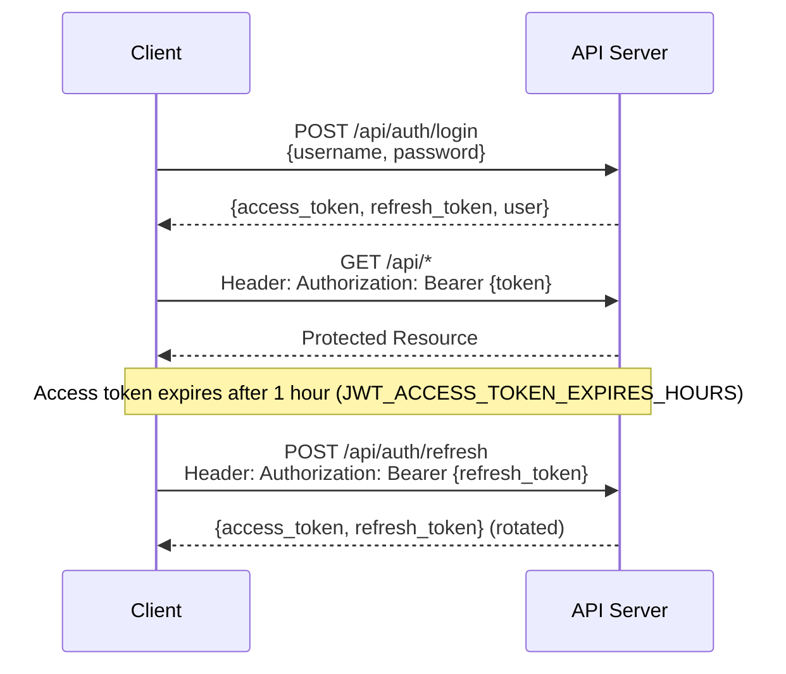
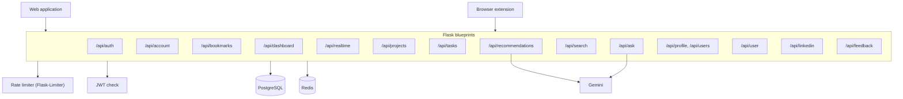

# API Architecture

Complete API documentation for Fuze - Intelligent Bookmark Manager.

## Table of Contents

1. [API Overview](#api-overview)
2. [Authentication](#authentication)
3. [API Endpoints](#api-endpoints)
4. [Request/Response Format](#requestresponse-format)
5. [Error Handling](#error-handling)
6. [Rate Limiting](#rate-limiting)

---

## API Overview

**Base URL**: `/api`

**Architecture**: Blueprint-based modular design

**Authentication**: JWT (JSON Web Tokens)

**Errors**: every non-2xx JSON body is `{"error": "<snake_case_code>", "message": "<sentence>"}`; see [Error Handling](#error-handling)

**Content Type**: `application/json`

**Status Codes**:
- `200` - Success
- `201` - Created
- `400` - Bad Request
- `401` - Unauthorized
- `403` - Forbidden
- `404` - Not Found
- `409` - Conflict
- `413` - Payload Too Large (request body over `MAX_REQUEST_BYTES`, 5 MB by default; imports over 5000 items)
- `429` - Too Many Requests
- `500` - Internal Server Error
- `503` - Service Unavailable

---

## Authentication

### JWT Token Flow



**Token Storage**:
- The web app keeps both tokens in `localStorage['user']`. The SPA is served from a
  different site than the API, so the SameSite=Lax refresh cookie isn't sent on its
  requests; it sends the refresh token in the `Authorization` header instead
  (`/api/auth/refresh` also accepts the cookie)
- Tokens are also set as HTTP-only cookies

**Sessions**: every login starts a token family. A refresh rotates the refresh token;
reusing an old one revokes the whole family. Refresh tokens without a family are
rejected. Revoking a session (logout, password change, reuse) also blocks its
still-valid access tokens through a short-lived `revoked_family` marker the JWT
blocklist checks. Changing the password ends every other session.

**Token Validation**: All protected endpoints validate JWT on every request

---

## API Endpoints

### Authentication (`/api/auth`)

| Method | Endpoint | Auth | Description |
|--------|----------|------|-------------|
| `POST` | `/api/auth/register` | ❌ | Register new user |
| `POST` | `/api/auth/login` | ❌ | Login user |
| `POST` | `/api/auth/refresh` | Refresh token | Rotate tokens |
| `POST` | `/api/auth/fork-session` | Refresh token (header) | Start a separate session for another client (the browser extension) |
| `POST` | `/api/auth/logout` | ✅ | Logout user (revokes the session) |
| `GET` | `/api/auth/verify` | ✅ | Verify token; returns a whitelisted profile |
| `POST` | `/api/auth/verify-token` | ✅ | Verify token status |
| `POST` | `/api/auth/check-username` | ❌ | Check username availability |
| `POST` | `/api/auth/bulk-check-usernames` | ❌ | Check several usernames |
| `POST` | `/api/auth/set-password` | ✅ | Set a password (Google-created accounts: needs a sign-in in the last 15 minutes) |
| `POST` | `/api/auth/update-username` | ✅ | Change username |
| `POST` | `/api/auth/supabase-oauth` | ❌ | Exchange a Supabase (Google) access token for a session. Signs in only the account linked to that Google identity; `409 account_link_required` if an unlinked account has the same email |
| `POST` | `/api/auth/link-oauth` | ✅ | Connect Google to the signed-in account (email must match) |

**Login lockout**: failed passwords are counted per (account, client IP): five wrong
guesses block that client, not the owner signing in from elsewhere. The account-wide
lock is at 50 failures (5 when Redis is unavailable). A password lockout doesn't
block Google sign-in.

**Fork session** (`POST /api/auth/fork-session`, 20 per hour per IP): refresh tokens
rotate and a replayed one revokes its whole family, so two clients can't share one. The
client sends the web app's current refresh token in the `Authorization: Bearer` header
and receives a new token family of its own; the web app's token is not rotated and keeps
working. Only a refresh token that is the family's current one is accepted (an access
token, a spent or revoked one, or one without a family returns `401 invalid_refresh_token`).
The new family inherits the parent's start time, so it doesn't count as a fresh sign-in for
"signed in recently" checks, and no cookies are set.

```json
{
  "access_token": "eyJ0eXAiOiJKV1QiLCJhbGc...",
  "refresh_token": "eyJ0eXAiOiJKV1QiLCJhbGc...",
  "user": {"id": 1, "username": "johndoe", "email": "john@example.com"}
}
```

**Register Request**:
```json
{
  "username": "johndoe",
  "email": "john@example.com",
  "password": "SecurePass123"
}
```

**Login Request**:
```json
{
  "username": "johndoe",
  "password": "SecurePass123"
}
```

**Login Response**:
```json
{
  "access_token": "eyJ0eXAiOiJKV1QiLCJhbGc...",
  "refresh_token": "eyJ0eXAiOiJKV1QiLCJhbGc...",
  "user": {
    "id": 1,
    "username": "johndoe",
    "email": "john@example.com"
  }
}
```

---

### Account (`/api/account`)

| Method | Endpoint | Auth | Description |
|--------|----------|------|-------------|
| `GET` | `/api/account/export` | ✅ | Download everything the user stored as a JSON file (5 per hour) |
| `DELETE` | `/api/account` | ✅ | Delete the account and everything it owns, after re-authentication (5 per 15 minutes) |

**Export** (`GET /api/account/export`) returns `Content-Disposition: attachment;
filename=fuze-export-YYYY-MM-DD.json` and `Cache-Control: no-store`. The document contains
`format_version`, `exported_at`, `profile`, `bookmarks` (id, url, title, notes, tags,
category, saved_at, scrape_status, extracted_text), `projects` (each with its tasks and
subtasks), `feedback` and `recommendation_feedback` (including the per-project
`project_id`). It never contains the password hash, API keys, embeddings or sessions.
`404 user_not_found` if the account no longer exists.

**Delete Account Request**:
```json
{
  "password": "SecurePass123"
}
```

Accounts with a usable password must send `password`: missing is `400 password_required`,
wrong is `403 invalid_password`. Accounts created through Google sign-in that never set a
password send no body and instead need a sign-in within the last 15 minutes, otherwise
`403 recent_sign_in_required`. (Failures are 403 rather than 401 so the web app does not
refresh the token and retry.) On success every session is revoked, the user's rows are
deleted table by table (chunks, events, feedback, analyses, metadata, subtasks, tasks,
projects, bookmarks, token families, the user), the current access token is blocked, the
user's Redis keys are purged best-effort, and the auth cookies are cleared:
```json
{"message": "Account deleted"}
```

---

### Dashboard (`/api/dashboard`)

| Method | Endpoint | Auth | Description |
|--------|----------|------|-------------|
| `GET` | `/api/dashboard/summary` | ✅ | Everything the dashboard shows in one request |

The response is cached in Redis per user for 30 seconds. It contains `profile`
(`id`, `username`, `email`, `created_at`), `apiKeyStatus` (Gemini key and usage; a default
"no key" shape when unavailable), `pipeline_stats` (`scraping`, `embedding`, `analyzing`,
`analyzed` counts), `stats` (`total_bookmarks`, `active_projects`, `weekly_saves`,
`success_rate`, each `{value, change, change_value}`), `recentBookmarks` (the latest 5,
without the extracted text), `recentProjects` (the latest 3 with `task_count`),
`totalProjects` and `totalBookmarks`. `GET /api/bookmarks/dashboard/stats` serves the
bookmark statistics alone.

---

### Bookmarks (`/api/bookmarks`)

| Method | Endpoint | Auth | Description |
|--------|----------|------|-------------|
| `POST` | `/api/bookmarks` | ✅ | Save bookmark |
| `POST` | `/api/bookmarks/quick-save` | ✅ | Quick save bookmark (minimal fields) |
| `GET` | `/api/bookmarks` | ✅ | List bookmarks (paginated) |
| `DELETE` | `/api/bookmarks/<id>` | ✅ | Delete bookmark by ID |
| `DELETE` | `/api/bookmarks/url/<url>` | ✅ | Delete bookmark by URL |
| `DELETE` | `/api/bookmarks/all` | ✅ | Delete all bookmarks |
| `GET` | `/api/bookmarks/lookup?url=<url>` | ✅ | Find the caller's bookmark saved under exactly that URL |
| `GET` | `/api/bookmarks/dashboard/stats` | ✅ | Get dashboard statistics |
| `POST` | `/api/bookmarks/import` | ✅ | Bulk import bookmarks |
| `POST` | `/api/bookmarks/check-duplicate` | ✅ | Check if URL is duplicate |
| `GET` | `/api/bookmarks/import/progress` | ✅ | Get import progress |
| `GET` | `/api/bookmarks/import/progress/stream` | ✅ | Stream import progress (SSE) |
| `GET` | `/api/bookmarks/analysis/progress` | ✅ | Get analysis progress |
| `GET` | `/api/bookmarks/analysis/progress/stream` | ✅ | Stream analysis progress (SSE) |
| `GET` | `/api/bookmarks/progress/check` | ✅ | One-shot pipeline progress |
| `POST` | `/api/bookmarks/extract-url` | ✅ | Extract content from URL (fetched through the SSRF-safe client) |

Saving never fails because the queue is down: the bookmark is committed as `PENDING`
and the pipeline reconciler enqueues it later. URLs over 2048 bytes are rejected.

### Live Events (`/api/realtime`)

| Method | Endpoint | Auth | Description |
|--------|----------|------|-------------|
| `POST` | `/api/realtime/stream-ticket` | ✅ | Mint a short-lived, single-use ticket for opening the SSE stream |
| `GET` | `/api/realtime/stream` | ✅ or `?ticket=` | Pipeline and domain events for the user (SSE). Also served at `/api/bookmarks/progress/stream` |

`EventSource` can't send an `Authorization` header, so the browser first mints a
ticket and opens the stream with `?ticket=...`; access tokens never go in URLs. The
stream reads the user's Redis Stream (`fuze:events:stream:{user_id}`) with blocking
`XREAD`, and each entry's stream id is the SSE `id`: on reconnect the browser sends
it back as `Last-Event-ID` and reading resumes right after it. The progress SSE
endpoints authenticate with `verify_jwt_in_request` or a stream ticket, so revoked
tokens and refresh tokens are refused.

**Lookup** (`GET /api/bookmarks/lookup?url=<url>`): exact match on the stored URL (no
normalization). The extension uses it to resolve a removed Chrome bookmark to its Fuze id
before deleting by id. The URL is a query parameter rather than a path segment because
proxies may collapse the `//` of the scheme in a path. Returns
`{"bookmark": {"id": 42, "url": "...", "title": "..."}}`; `400 url_required`,
`400 url_too_long`, or `404 bookmark_not_found`.

**Save Bookmark Request**:
```json
{
  "url": "https://example.com/article",
  "title": "Article Title",
  "description": "Optional description",
  "category": "technology",
  "tags": ["python", "web"]
}
```

**List Bookmarks Query Params**:
- `page` (default: 1)
- `per_page` (default: 10, max: 100)
- `search` (optional)
- `category` (optional)

**Bulk Import Request** (at most 5000 items per request; the extension sends 1000 at a time):
```json
[
  {
    "url": "https://example.com/1",
    "title": "Article 1"
  },
  {
    "url": "https://example.com/2",
    "title": "Article 2"
  }
]
```

---

### Projects (`/api/projects`)

| Method | Endpoint | Auth | Description |
|--------|----------|------|-------------|
| `GET` | `/api/projects` | ✅ | List projects (paginated) |
| `POST` | `/api/projects` | ✅ | Create project |
| `GET` | `/api/projects/<id>` | ✅ | Get project by ID |
| `PUT` | `/api/projects/<id>` | ✅ | Update project |
| `DELETE` | `/api/projects/<id>` | ✅ | Delete project |
| `GET` | `/api/projects/<id>/tasks` | ✅ | Get project tasks |
| `GET` | `/api/projects/user/<user_id>` | ✅ | Paginated projects of a user; `<user_id>` must be the caller (`403 forbidden` otherwise) |

**Create Project Request**:
```json
{
  "title": "My Project",
  "description": "Project description",
  "technologies": "React, Node.js, PostgreSQL"
}
```

**List Projects Query Params**:
- `page` (default: 1)
- `per_page` (default: 10)
- `include_tasks` (default: true)

`GET /api/projects/user/<user_id>` takes `page` (default 1) and `per_page` (default 10,
max 100) and returns `{"projects": [{id, title, description, technologies, created_at}],
"total", "page", "per_page", "pages"}` without tasks.

---

### Recommendations (`/api/recommendations`)

| Method | Endpoint | Auth | Description |
|--------|----------|------|-------------|
| `POST` | `/api/recommendations/unified-orchestrator` | ✅ | **Primary** - Intent × content engine (query or `project_id`/`task_id`/`subtask_id`) |
| `POST` | `/api/recommendations/generate-context` | ✅ | Gemini explanation of how one item helps with the current context |
| `POST` | `/api/recommendations/task/<id>` | ✅ | Task-based recommendations |
| `POST` | `/api/recommendations/subtask/<id>` | ✅ | Subtask-based recommendations |
| `GET` | `/api/recommendations/status` | ❌ | Get engine status |
| `POST` | `/api/recommendations/cache/clear` | ✅ | Clear recommendation cache |
| `POST` | `/api/recommendations/cache/clear-context` | ✅ | Clear context cache |
| `POST` | `/api/recommendations/cache/clear-all-recommendations` | ✅ | Clear all recommendation cache |
| `GET` | `/api/recommendations/analysis/stats` | ✅ | Get analysis statistics |
| `POST` | `/api/recommendations/analysis/analyze-content/<id>` | ✅ | Analyze specific content |
| `POST` | `/api/recommendations/feedback` | ✅ | Submit recommendation feedback (`feedback_data` keys are whitelisted; references to other users' projects/tasks are dropped) |
| `GET` | `/api/recommendations/suggested-contexts` | ✅ | Suggested contexts (only the caller's own projects) |
| `GET` | `/api/recommendations/recent-contexts` | ✅ | Recently used contexts |
| `GET` | `/api/recommendations/gemini-status` | ✅ | Whether a server-side `GEMINI_API_KEY` is configured |
| `GET` | `/api/recommendations/user-preferences` | ✅ | Feedback counts by type, bookmark statistics and top tags for the caller |
| `GET` | `/api/recommendations/learning-insights` | ✅ | Technologies from the caller's 20 most recent bookmarks |
| `GET` | `/api/recommendations/performance-metrics` | ✅ | Redis cache statistics and database totals (`total_content`, `analyzed_content`, `analysis_coverage`; counted across all users) |

**Unified Orchestrator Request** (15 per minute per user). Send either free text or a
stored context (`project_id`, `task_id`, `subtask_id`). With a project or task the stored
context is the intent and only `user_interests` is used from the request text; otherwise
`title`, `description`, `technologies` and `user_interests` are joined into the query.
```json
{
  "title": "Learn React hooks",
  "description": "Building a dashboard",
  "technologies": "React",
  "user_interests": "state management",
  "project_id": 7,
  "max_recommendations": 10
}
```

Limits: `title` 500 characters, `description` 5000, `technologies` 1000
(`400 title_too_long` and similar). `max_recommendations` defaults to 10 and is capped at 50.
`POST /api/recommendations/task/<id>` and `/subtask/<id>` accept `max_recommendations`
and return the same `recommendations` list plus the task (and subtask) id and title.

**Response**:
```json
{
  "recommendations": [
    {
      "id": 123,
      "title": "React Hooks Guide",
      "url": "https://example.com/react-hooks",
      "score": 95.0,
      "confidence": 95.0,
      "reason": "Matches what you're working on: ...",
      "basic_summary": "...",
      "content_type": "article",
      "difficulty": "mixed",
      "technologies": ["react"],
      "key_concepts": ["hooks"],
      "quality_score": 8.5,
      "engine_used": "intent_engine",
      "metadata": {"matched_passage": "...", "use_when": null, "vector_similarity": 0.8123, "rerank_score": null}
    }
  ],
  "total_recommendations": 1,
  "engine_used": "intent_engine",
  "intent": {"intent_text": "...", "intent_statement": null, "needs": [], "intent_source": "context"},
  "cached": false,
  "performance_metrics": {"response_time_ms": 120.5},
  "request_processed": {"project_id": 7, "task_id": null, "subtask_id": null}
}
```

Results are only the caller's own saved content. `score` is a 0-100 match percentage.

**Feedback** (`POST /api/recommendations/feedback`):
```json
{
  "recommendation_id": 123,
  "feedback_type": "positive",
  "feedback_data": {"source": "recommendations_page", "project_id": 7, "task_id": 3, "position": 2, "score": 91.2}
}
```
`recommendation_id` and `feedback_type` are required (`400 missing_fields`).
`positive`, `negative` and `neutral` are stored as `helpful`, `not_relevant` and `clicked`;
other accepted types are `saved`, `like`, `dislike` and `completed`. The bookmark must
belong to the caller. Only the `feedback_data` keys `source`, `timestamp`, `project_id`,
`task_id`, `query`, `position` and `score` (scalar values) are kept, and a `project_id` or
`task_id` the caller does not own is dropped. A kept `project_id` is stored in the
`user_feedback.project_id` column (in addition to the `context_data` JSON), because a
bookmark can be right for one project and wrong for another; the column is set to NULL
if the project is later deleted, so the judgment of the bookmark itself survives.
Response: `{"message": "Feedback recorded successfully", "feedback_id": 1}`.

**Preferences and insights**: `GET /api/recommendations/user-preferences` returns
`{user_id, feedback_patterns: {<feedback_type>: count}, content_statistics:
{total_bookmarks, avg_quality_score}, top_technologies: [{technology, count}] (up to 10),
learning_style}`. `GET /api/recommendations/learning-insights` returns `{user_id,
learning_trends: {recent_technologies, learning_velocity}, recommendations: [...],
engine_used: "basic_insights"}`, derived from the tags of the 20 most recent bookmarks.

---

### Search (`/api/search`)

| Method | Endpoint | Auth | Description |
|--------|----------|------|-------------|
| `POST` | `/api/search/semantic` | ✅ | Semantic search (vector similarity) |
| `GET` | `/api/search/text` | ✅ | Text search (keyword-based) |
| `POST` | `/api/search/supabase-semantic` | ✅ | Same search as `/semantic`; the name is kept for the web app |

Semantic search ranks passages, and merges in bookmarks that have no chunks yet by
their document embedding, so nothing still processing drops out. It only compares
embeddings from the active model and returns the real cosine similarity. If the
query can't be embedded the endpoint returns 503 rather than a meaningless ranking.

**Semantic Search Request**:
```json
{
  "query": "machine learning tutorials",
  "limit": 10
}
```

**Text Search Query Params**:
- `q` - Search query (an empty query returns an empty result)
- `limit` (default: 10)

Both searches clamp `limit` to 1-100 and reject over-long queries with `400 query_too_long`. The response is `{"query", "results", "total"}`.

---

### Ask your bookmarks (`/api/ask`)

| Method | Endpoint | Auth | Description |
|--------|----------|------|-------------|
| `POST` | `/api/ask` | ✅ | Answer a question only from the user's saved content, with numbered citations |

**Request**: `{"question": "...", "limit": 10}`. The question is 3-500 characters;
`limit` is the number of passages given to the model (1-12, default 10).

**Response**:
```json
{
  "answer": "Raise ef_search for better recall [1]. IVFFlat is the alternative [2].",
  "citations": [
    {"n": 1, "bookmark_id": 42, "title": "HNSW tuning", "url": "https://...", "snippet": "..."}
  ],
  "used_passages": 8
}
```

How it works (`services/ask_service.py`):
- **Retrieval** uses the same meaning-only index as semantic search, with no keyword matching.
  It takes the nearest saved-text passages from `content_chunks` (`hybrid_search.nearest_passages`;
  Gemini's `profile` rows are excluded because they are not the user's own text), and adds
  bookmarks with no chunks yet by their document embedding. Every query is filtered by
  `user_id` and the active embedding model. It allows at most 2 passages per bookmark,
  `limit` passages in total, and a context budget of about 3,500 tokens.
- **No relevant passages**: the endpoint returns an honest "not in your bookmarks" answer
  without calling Gemini or spending quota.
- **Generation** uses the user's key (`get_user_api_key`), with no database session open
  during the call. Passages are wrapped in per-request random delimiters, and the model is
  told to treat them as untrusted data: answer only from them, cite them as `[n]`, and say so
  when they don't contain the answer.
- **Citations** are parsed from the answer. Numbers outside the passages that were sent are
  removed from the text and never returned.

**Errors** (`{"error", "message"}`): `400 invalid_question`; `402 gemini_key_required`
(no usable key); `429 gemini_quota_exceeded` (per-user Gemini quota, or the day's share of
the shared key is used up; includes `Retry-After`); `503 generation_failed` or
`503 ask_unavailable`. The response isn't streamed: answers are short, and a single JSON
response lets citations be validated before anything is shown.

---

### Profile (`/api/profile`)

| Method | Endpoint | Auth | Description |
|--------|----------|------|-------------|
| `GET` | `/api/profile` | ✅ | Get user profile (includes `has_password` and `google_connected`) |
| `PUT` | `/api/profile` | ✅ | Update profile |
| `PUT` | `/api/users/<id>` | ✅ | Update user (compatibility) |
| `PUT` | `/api/users/<id>/password` | ✅ | Change password |

### User API Key (`/api/user`)

| Method | Endpoint | Auth | Description |
|--------|----------|------|-------------|
| `POST` | `/api/user/api-key` | ✅ | Add/update user's API key |
| `GET` | `/api/user/api-key` | ✅ | Get user's API key info |
| `DELETE` | `/api/user/api-key` | ✅ | Delete user's API key |
| `GET` | `/api/user/api-key/status` | ✅ | Get API key status |
| `POST` | `/api/user/api-key/test` | ✅ | Test API key validity |
| `GET` | `/api/user/api-key/usage` | ✅ | Get API key usage statistics |

### Tasks (`/api/tasks`)

| Method | Endpoint | Auth | Description |
|--------|----------|------|-------------|
| `POST` | `/api/tasks` | ✅ | Create task |
| `GET` | `/api/tasks/project/<id>` | ✅ | Get project tasks |
| `POST` | `/api/tasks/ai-breakdown` | ✅ | AI-powered task breakdown |
| `PUT` | `/api/tasks/<id>` | ✅ | Update task |
| `DELETE` | `/api/tasks/<id>` | ✅ | Delete task |
| `POST` | `/api/tasks/<id>/subtasks` | ✅ | Create subtask |
| `GET` | `/api/tasks/<id>/subtasks` | ✅ | Get task subtasks |
| `PUT` | `/api/tasks/subtasks/<id>` | ✅ | Update subtask |
| `DELETE` | `/api/tasks/subtasks/<id>` | ✅ | Delete subtask |

### LinkedIn (`/api/linkedin`)

| Method | Endpoint | Auth | Description |
|--------|----------|------|-------------|
| `POST` | `/api/linkedin/extract` | ✅ | Extract LinkedIn post content |
| `POST` | `/api/linkedin/analyze` | ✅ | Analyze LinkedIn content (same content profile as other bookmarks; 502 when the model returns nothing usable) |
| `POST` | `/api/linkedin/batch-extract` | ✅ | Batch extract LinkedIn posts |
| `GET` | `/api/linkedin/history` | ✅ | Get extraction history |
| `POST` | `/api/linkedin/save-to-bookmarks` | ✅ | Save LinkedIn content to bookmarks |
| `DELETE` | `/api/linkedin/extract/<id>` | ✅ | Delete extraction |
| `GET` | `/api/linkedin/status` | ✅ | Get LinkedIn service status |

### Feedback (`/api/feedback`)

| Method | Endpoint | Auth | Description |
|--------|----------|------|-------------|
| `POST` | `/api/feedback` | ✅ | Submit or update relevance feedback for one of the caller's bookmarks |

**Request**: `{"content_id": 42, "feedback_type": "relevant"}`; `feedback_type` is
`relevant` or `not_relevant`. One row exists per user and bookmark (a second submission
updates it). A `project_id` in the request is ignored: the server derives it and does not
trust client input. `404 content_not_found` if the bookmark is not the caller's. Response:
`{"message": "Feedback recorded"}`.

Per-project feedback (judging a bookmark for a specific project) is recorded by
`POST /api/recommendations/feedback` above. Ask (`/api/ask`) neither reads nor writes
feedback.

**Update Profile Request**:
```json
{
  "username": "newusername",
  "technology_interests": "Python, React, AI"
}
```

**Change Password Request**:
```json
{
  "current_password": "OldPass123",
  "new_password": "NewPass123"
}
```

---

### Health Check

| Method | Endpoint | Auth | Description |
|--------|----------|------|-------------|
| `GET` | `/api/health` | ❌ | Up/down for database and Redis |
| `GET` | `/health/liveness` | ❌ | Process alive (Docker `HEALTHCHECK`) |
| `GET` | `/health/readiness` | ❌ | 503 unless database, Redis and schema (Alembic head of this build) are ready |
| `GET` | `/api/health/database`, `/api/health/redis` | ❌ | Single-dependency up/down |
| `GET` | `/api/health/queue`, `/api/health/detailed` | `X-Internal-Token` | Queue depth and failed jobs / cache stats; 404 unless `INTERNAL_HEALTH_TOKEN` is set and sent |
| `GET` | `/metrics` | Bearer `METRICS_AUTH_TOKEN` | Prometheus metrics; 404 unless the token is configured |

Public health endpoints report up/down only: no hostnames, error text or environment.

**Response** (`/api/health`):
```json
{
  "status": "healthy",
  "database": "connected",
  "redis": {"connected": true}
}
```

---

## Request/Response Format

### Request Headers

**Required for Protected Endpoints**:
```
Authorization: Bearer {access_token}
Content-Type: application/json
```

**Optional**:
```
X-Request-ID: {unique_request_id}  # For request tracking
```

### Response Format

**Success Response**: a JSON object shaped per endpoint (see the examples above); there is
no common envelope. Simple mutations return `{"message": "..."}`.

**Error Response**:
```json
{
  "error": "snake_case_code",
  "message": "Human-readable description"
}
```

### Pagination

**Paginated Response**: the list key is named after the resource (`bookmarks`, `projects`);
the rest is shared:
```json
{
  "bookmarks": [...],
  "total": 100,
  "page": 1,
  "per_page": 10,
  "pages": 10
}
```

---

## Error Handling

### Error Codes

Every non-2xx JSON body has one shape (`core/http_errors.py`):

```json
{
  "error": "content_not_found",
  "message": "Content not found"
}
```

`error` is a stable snake_case code clients branch on; `message` is for people and may be
reworded. Some responses add fields, for example `suggestions` on a username conflict or
`retry_after` on a 429. A bare HTTP error gets the code for its status (`bad_request`,
`unauthorized`, `forbidden`, `not_found`, `conflict`, `payload_too_large`,
`rate_limit_exceeded`, `internal_error`, `service_unavailable`, and so on).

### Comprehensive Error Handling System

Fuze has a robust, user-friendly error handling system that provides consistent error display, proper logging, and actionable user feedback.

#### Error Categories

| Type | Description | User Message |
|------------|-------------|--------------|
| `NETWORK` | Connection issues | "Network connection failed. Please check your internet and try again." |
| `AUTH`  | Authentication problems | "Your session has expired. Please log in again." |
| `VALIDATION` | Input validation errors | "Please check your input and try again." |
| `SERVER`  | Server-side issues | "Server error occurred. Please try again later." |
| `RATE_LIMIT` | Rate limiting | "Too many requests. Please wait a moment before trying again." |
| `UNKNOWN`  | Unexpected errors | "An unexpected error occurred. Please try again." |

#### HTTP Status Code Mapping

- **400**: Validation Error
- **401/403**: Authentication Error
- **404**: Not Found (treated as generic error)
- **409**: Conflict (Validation Error)
- **422**: Unprocessable Entity (Validation Error)
- **429**: Too Many Requests (Rate Limit)
- **5xx**: Server Error

#### Frontend Error Handling

**Components:**
1. **API Error Handler** (`services/api.js`)
   - Central error processing and categorization
   - User-friendly message mapping
   - Retry logic with exponential backoff

2. **Error Handler Hook** (`hooks/useErrorHandler.js`)
   - React hook for consistent error handling in components
   - Automatic toast notifications
   - Context-aware error messages

3. **Error Boundary** (`components/ErrorBoundary.jsx`)
   - Catches rendering errors so one failing component does not blank the app

4. **Toast System** (`contexts/ToastContext.jsx`)
   - Notifications for success and error states

#### Error Logging

- Detailed error information in development console
- Stack traces for debugging
- Context information for error identification
- Full traceback and context in error logs

---

## Rate Limiting

### Rate Limits (Flask-Limiter)

| Endpoint Pattern | Limit | Window | Scope |
|------------------|-------|--------|-------|
| `/api/auth/login`, `/api/auth/set-password`, `PUT /api/users/<id>/password` | 5 requests | 15 minutes | Per user, else per IP |
| `/api/auth/register`, `/api/auth/update-username` | 10 requests | 1 hour | Per user, else per IP |
| `/api/auth/check-username` | 30 requests | 1 minute | Per IP |
| `/api/auth/bulk-check-usernames` | 20 requests | 1 minute | Per IP |
| `/api/auth/fork-session` | 20 requests | 1 hour | Per IP |
| `DELETE /api/account` | 5 requests | 15 minutes | Per user |
| `GET /api/account/export` | 5 requests | 1 hour | Per user |
| `/api/recommendations/unified-orchestrator` | 15 requests | 1 minute | Per User |
| `/api/recommendations/generate-context` | 10 requests | 1 minute | Per User |
| `/api/search/semantic` | 30 requests | 1 minute | Per User |
| `/api/ask` | 10/min, 100/day | moving window | Per User |
| `/api/linkedin/batch-extract` | 5 requests | 1 minute | Per User |
| All other endpoints | 50/min, 200/hour, 1000/day | moving window | Per user, else per IP |

**Note**: Limits use Redis storage (moving window). In production a missing
`REDIS_URL` or a limiter setup failure aborts startup; in-memory storage is only used
outside production. Development and testing use much higher defaults.

**Gemini usage**: users without their own Gemini key share the system key, up to
`SYSTEM_GEMINI_DAILY_LIMIT_PER_USER` uses a day each (default 30); after that they
are asked to add a key and background analysis waits. Per-user quota counters are
fixed windows (minute/day/month) that reset.

### Rate Limit Headers

**Response Headers**:
```
X-RateLimit-Limit: 20
X-RateLimit-Remaining: 15
X-RateLimit-Reset: 1609459200
```

**Rate Limit Exceeded Response**:
```json
{
  "error": "rate_limit_exceeded",
  "message": "Too many requests. Please slow down and try again later.",
  "retry_after": "60"
}
```

**Status Code**: `429 Too Many Requests`

---

## API Architecture Diagram


