# System Architecture - Scalable Design

Complete scalable architecture documentation for Fuze - Intelligent Content Manager.

## ⚠️ Important: Current Implementation vs Scalable Design

> [!WARNING]
> **Deployment status:** the hosted backend runs on a Hugging Face Space and
> was paused by HF's abuse detection and is pending unpause. HF now requires a paid PRO subscription to *create* new Docker
> Spaces on the free tier, so a free/low-cost fallback host is being
> evaluated. The image contains no browser-automation tooling;
> scraping is plain HTTP only. See the
> root [`README.md`](../README.md) and
> [`gaps_closure_plan.md`](../gaps_closure_plan.md).

**This document describes both:**
- **Current Implementation**: The single-container design this repo actually runs (whichever host it's deployed to)
- **Scalable Design**: Architecture that supports future scaling (ready for horizontal scaling)

**Key Distinction:**
- **Current**: 2 Gunicorn workers (gevent, sized for a 2-vCPU host), single database, single Redis, RQ workers, no load balancer (platform handles routing)
- **Scalable**: Architecture designed to support multiple workers, load balancers, database replicas, Redis clusters when needed
- **Why**: Stateless design means scaling is just configuration changes, not code changes

## Table of Contents

1. [System Overview](#system-overview)
2. [Architecture Layers](#architecture-layers)
3. [Database Architecture](#database-architecture)
4. [Caching Architecture](#caching-architecture)
5. [Horizontal Scaling Strategy](#horizontal-scaling-strategy)
6. [Load Distribution](#load-distribution)
7. [Data Isolation & Security](#data-isolation--security)
8. [Background Processing Architecture](#background-processing-architecture)
9. [ML/AI Architecture](#mlai-architecture)
10. [API Architecture](#api-architecture)
11. [Frontend Architecture](#frontend-architecture)
12. [Deployment Architecture](#deployment-architecture)

---

## System Overview

Fuze is built as a scalable, multi-tenant system designed to handle thousands of concurrent users with individual API keys, isolated data, and independent processing pipelines.

### Core Principles

1. **User Isolation**: Complete data isolation per user
2. **Horizontal Scalability**: Stateless design for easy scaling
3. **Shared Caching**: Redis (per-process caches only for feature flags and API keys)
4. **Background Processing**: Non-blocking async operations
5. **Connection Pooling**: Efficient database connection management
6. **Rate Limiting**: Per-user and per-IP rate limits
7. **Graceful Degradation**: System works even when components fail

### High-Level Architecture

**Current Implementation (What's Deployed):**

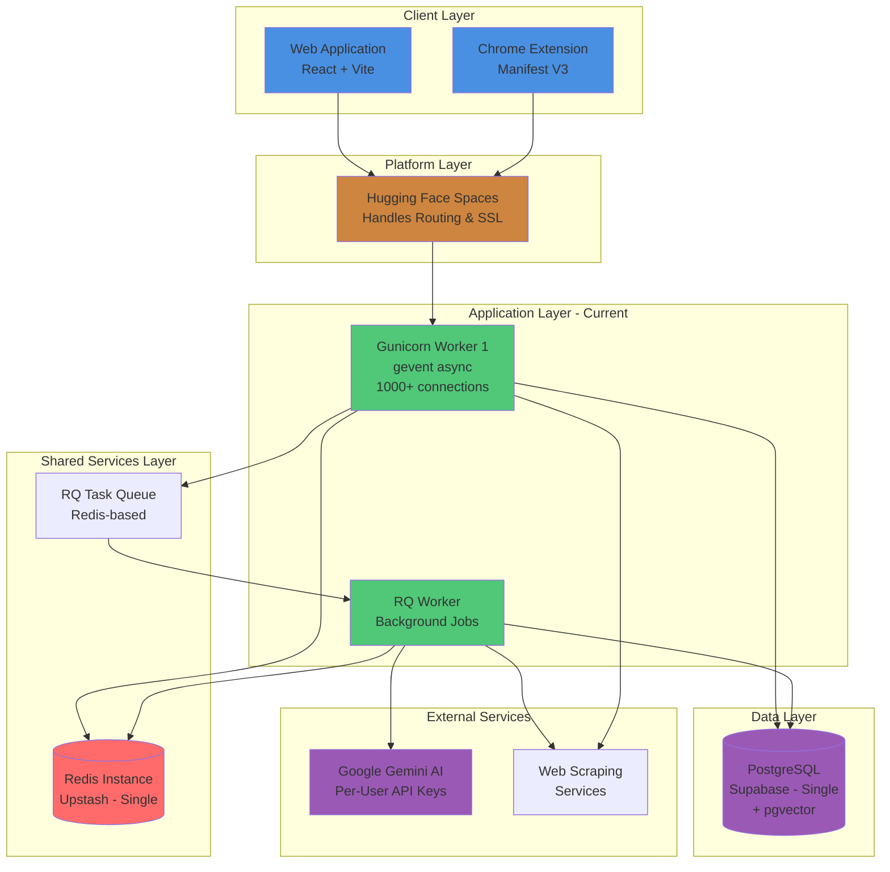

**Scalable Design (Future-Ready Architecture):**

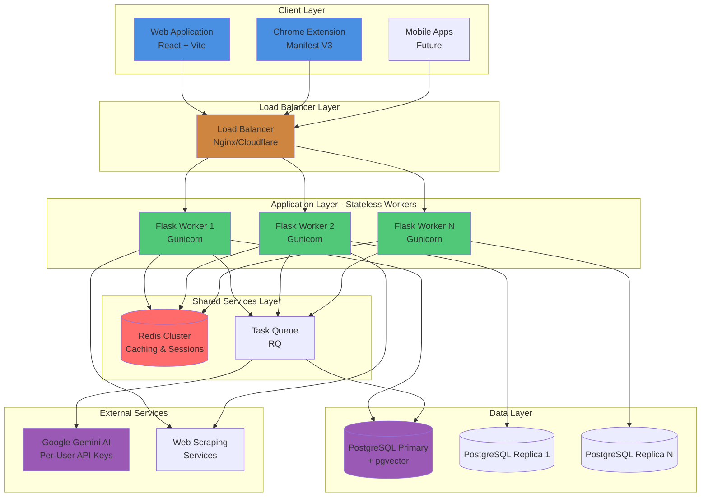

---

## Architecture Layers

### Layer 1: Client Layer

**Components:**
- Web Application (React + Vite)
- Chrome Extension (Manifest V3)
- Future: Mobile Apps

**Characteristics:**
- Stateless clients
- JWT token-based authentication
- API calls to backend
- Client-side caching

### Layer 2: Load Balancer Layer

**Current Implementation:**
- ❌ **Not Implemented**: No custom load balancer
- ✅ **Platform Handled**: Hugging Face Spaces handles routing, SSL termination, and health checks
- ✅ **Design Ready**: Architecture supports load balancer when needed

**Scalable Design (Future):**
- **Responsibilities:**
  - Request routing
  - SSL termination
  - Rate limiting (first line)
  - Health checks
  - Session affinity (if needed)
- **Implementation:**
  - Nginx or Cloudflare
  - Round-robin or least-connections
  - Health check endpoints

### Layer 3: Application Layer (Stateless Workers)

**Current Implementation:**
- ✅ **2 Gunicorn Workers**: gevent async I/O, sized for the 2-vCPU host
- ✅ **Gevent Worker Class**: up to 1000 connections per worker; psycogreen makes
  Postgres queries yield (5 concurrent `pg_sleep(1)`: 5.05 s unpatched, 1.01 s
  patched), and `model.encode` / bcrypt run on gevent's thread pool
  (`utils/cooperative.py`)
- ✅ **Stateless Design**: No local state, all state in Redis/DB
- ✅ **Connection Pooling**: 5 base, 10 overflow connections, 5 s connect timeout,
  15 s `statement_timeout` per connection, `sslmode=require` in production
- ✅ **RQ Workers**: `default` and `high` queues, supervised next to Gunicorn

**Current Configuration** (`gunicorn.conf.py`, started by `supervisord.conf`):
```python
workers = 2
worker_class = "gevent"
worker_connections = 1000
timeout = 60            # was 2000 s; a stuck worker is recycled within a minute
graceful_timeout = 30
preload_app = False     # each worker opens its own DB/Redis connections after fork

def post_fork(server, worker):
    from psycogreen.gevent import patch_psycopg
    patch_psycopg()
    torch.set_num_threads(1)
```

**Scalable Design (Future):**
- **Multiple Flask workers** (Gunicorn)
- **Stateless design** - no local state
- **Shared Redis** for sessions/cache
- **Connection pooling** to database
- **Scaling:**
  - Add/remove workers dynamically
  - Auto-scaling based on load
  - Each worker handles any request

### Layer 4: Shared Services Layer

**Current Implementation:**
- ✅ **Single Redis Instance**: Upstash (free tier)
- ✅ **RQ Task Queue**: Redis-based task queue (not Celery)
- ✅ **Shared Across Workers**: All workers use same Redis

**Scalable Design (Future):**
- **Redis Cluster** (caching, sessions, rate limiting)
- **Task Queue** (RQ/Background workers - already using RQ)
- **Message Broker** (for async tasks)

### Layer 5: Data Layer

**Current Implementation:**
- ✅ **Single PostgreSQL**: Supabase (single database instance)
- ✅ **pgvector Extension**: For vector search
- ✅ **Connection Pooling**: 5 base, 10 overflow connections
- ✅ **Alembic-Managed Indexes**: Optimized for performance (HNSW for vectors)
- ❌ **No Read Replicas**: All operations to single database

**Scalable Design (Future):**
- **PostgreSQL Primary** (writes)
- **PostgreSQL Replicas** (reads)
- **pgvector extension** for vector search
- **Connection pooling**
- **Read/write splitting** (architecture supports it)

---

## Database Architecture

### Database Schema Design

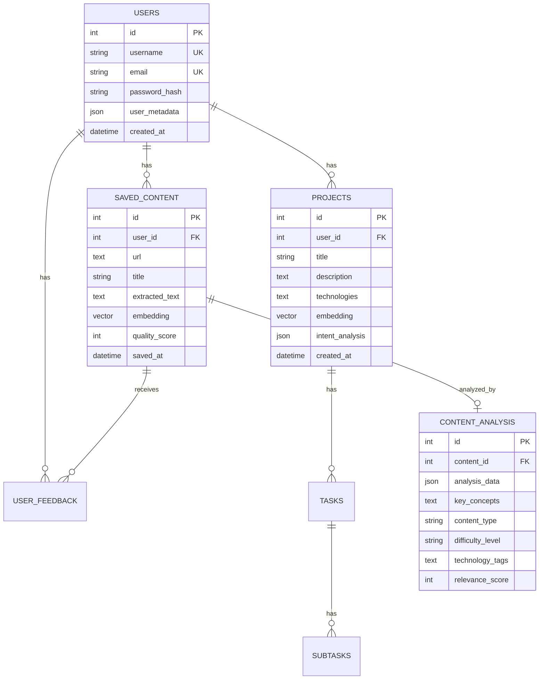

### Database Indexing Strategy

**Critical Indexes for Performance:**

```sql
-- User Isolation Indexes (CRITICAL for security and performance)
CREATE INDEX idx_saved_content_user_id ON saved_content(user_id);
CREATE INDEX idx_saved_content_user_quality ON saved_content(user_id, quality_score DESC);
CREATE INDEX idx_saved_content_user_saved_at ON saved_content(user_id, saved_at DESC);

-- Vector Search Indexes (pgvector)
CREATE INDEX idx_saved_content_embedding ON saved_content 
USING ivfflat (embedding vector_cosine_ops) WITH (lists = 100);

CREATE INDEX idx_projects_embedding ON projects 
USING ivfflat (embedding vector_cosine_ops) WITH (lists = 100);

-- Composite Indexes for Common Queries
CREATE INDEX idx_projects_user_created ON projects(user_id, created_at DESC);
CREATE INDEX idx_tasks_project_created ON tasks(project_id, created_at DESC);

-- Case-Insensitive Lookups
CREATE INDEX idx_users_username_lower ON users(LOWER(username));
CREATE INDEX idx_users_email_lower ON users(LOWER(email));
```

**Index Strategy:**
- **User Isolation First**: All queries filtered by `user_id` - indexes ensure fast lookups
- **Composite Indexes**: Cover common query patterns (user_id + sort column)
- **Vector Indexes**: IVFFlat indexes for fast similarity search
- **Partial Indexes**: Conditional indexes for filtered queries

### Connection Pooling Architecture

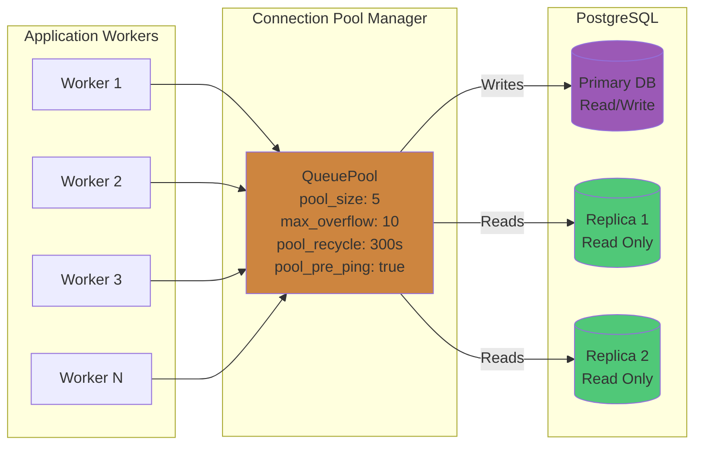

**Connection Pool Configuration:**
- **Pool Size**: 5 connections per worker
- **Max Overflow**: 10 additional connections
- **Pool Recycle**: 300 seconds (prevent stale connections)
- **Pool Pre-ping**: True (verify connections before use)
- **Connection Timeout**: 30 seconds
- **SSL Mode**: Auto-detected and configured

**Benefits:**
- Reuses connections (faster queries)
- Limits total connections (prevents DB overload)
- Automatic connection health checks
- Handles connection failures gracefully

### Read/Write Splitting Strategy

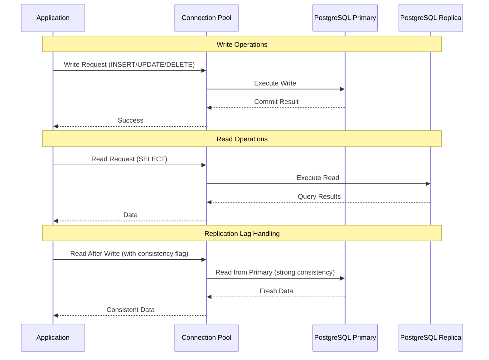

**Read/Write Splitting:**
- **Writes**: Always go to Primary
- **Reads**: Distributed across Replicas
- **Consistency**: Option to read from Primary for critical reads
- **Replication Lag**: Handled with read-after-write patterns

---

## Caching Architecture

### Caching Strategy

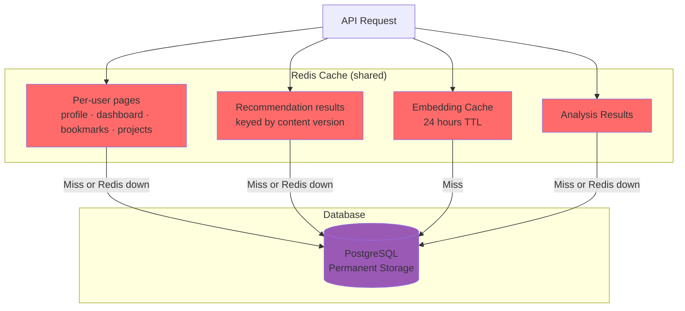

### Cache Layers Explained

#### In-Process (per worker)

Only values that rarely change: the embedding model instance (singleton), feature
flags (5 s TTL) and decrypted user API keys. User data is never cached per worker.

#### Redis Cache (Shared Across Workers)

**Location**: `backend/utils/redis_utils.py` (`RedisCache`); every per-user key is
built by `backend/core/cache_keys.py`, so readers and invalidators can't drift apart

**Cache Types:**

1. **Per-user pages**
   - Keys: `profile:{user_id}`, `dashboard:v1:summary:{user_id}`, `dashboard:stats:{user_id}`,
     `bookmarks:{user_id}:{page}:{per_page}:{search}:{category}`, `bookmarks:{user_id}:list`,
     `projects:{user_id}:{page}:{per_page}:{include_tasks}`
   - Purpose: fast page loads; the bookmark list also serves import dedup

2. **Recommendation Cache**
   - Keys include a per-user content version that bumps on every change, so stale
     results are never served
   - Purpose: Avoid recomputing recommendations

3. **Embedding Cache**
   - Key: hash of the text (`RedisCache.cache_embedding`)
   - TTL: 24 hours
   - Purpose: Avoid re-encoding identical text

4. **Analysis Cache**
   - Key: `content_analysis:{content_id}`
   - Stores: Gemini analysis results
   - Purpose: Reuse AI analysis

Fetched pages are not cached (the raw-HTML cache was never read, so it was removed).
Redis is optional on the request path: 2 s timeouts, no PING per operation, and a
reconnect attempt at most every 5 s while it is down.

**Cache Invalidation Strategy:**

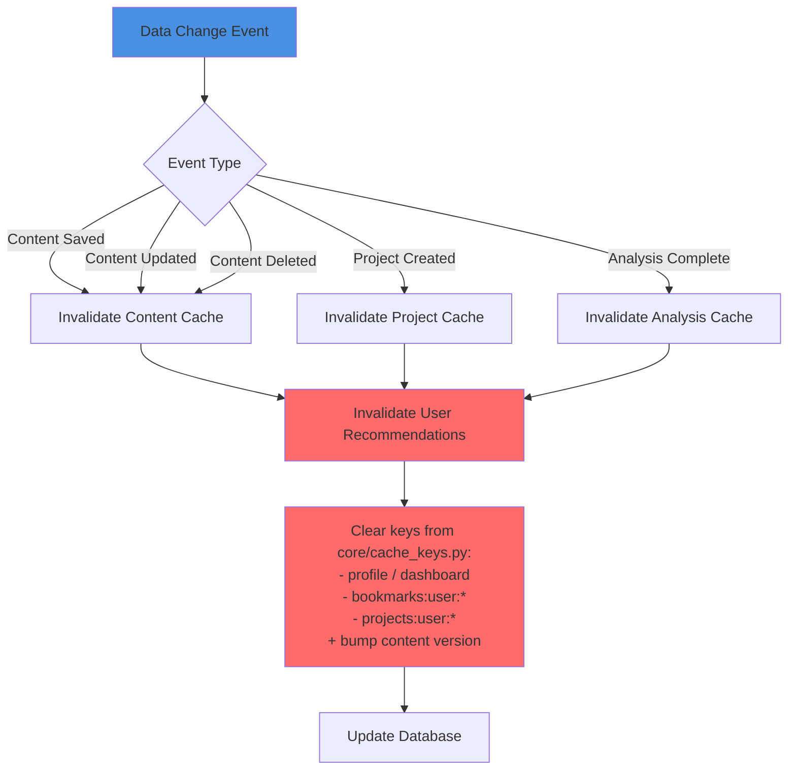

**Cache Invalidation Service:**
- Location: `backend/services/cache_invalidation_service.py`
- Automatic invalidation on data changes
- Pattern-based invalidation (wildcards), using the same key builders as the readers
- Comprehensive coverage (project lists included); `DELETE /api/bookmarks/all`
  clears synchronously
- Web requests invalidate on a background thread; RQ jobs invalidate inline (work
  horses exit via `os._exit()` and would kill the thread first)

---

## Horizontal Scaling Strategy

### Stateless Application Design

**Key Principle**: No local state in application workers

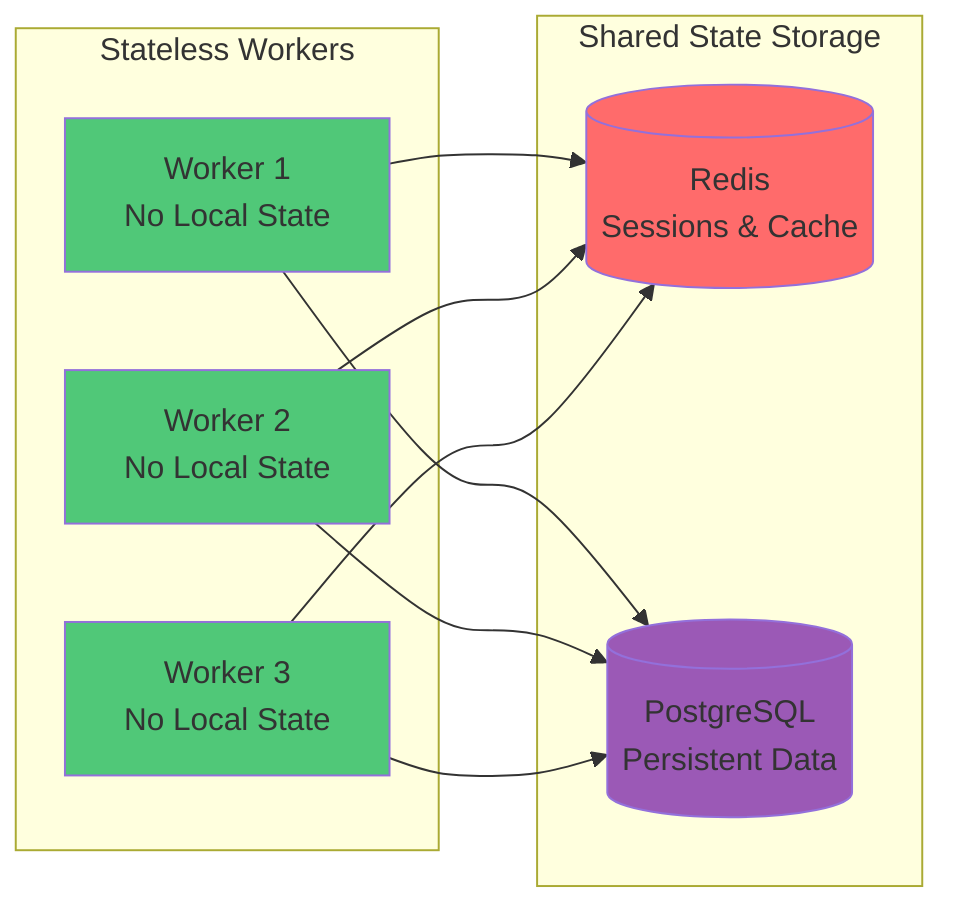

**Stateless Components:**
- ✅ JWT tokens (no server-side sessions)
- ✅ All state in Redis or Database
- ✅ No file uploads to workers
- ✅ No per-worker caches of user data (shared Redis instead)
- ✅ Connection pooling (managed by SQLAlchemy)

**Benefits:**
- Any worker can handle any request
- Easy to add/remove workers
- No session affinity required
- Horizontal scaling without limits

### User Isolation Architecture

**Critical for Multi-Tenancy:**

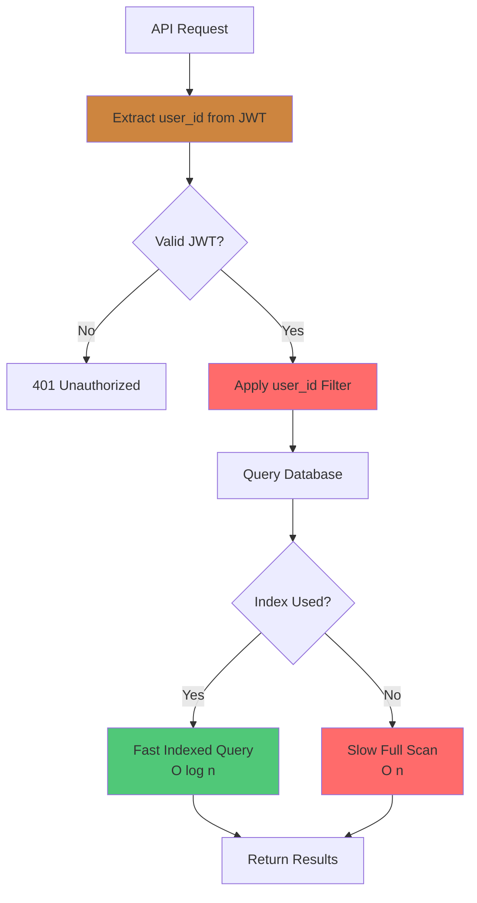

**User Isolation Implementation:**

1. **Database Level:**
   ```python
   # All queries automatically filtered by user_id
   SavedContent.query.filter_by(user_id=current_user_id).all()
   ```

2. **Index Level:**
   ```sql
   -- Composite indexes ensure fast user-specific queries
   CREATE INDEX idx_saved_content_user_quality 
   ON saved_content(user_id, quality_score DESC);
   ```

3. **Application Level:**
   ```python
   # Security middleware enforces user_id in all queries
   @require_user_context
   def get_user_bookmarks(user_id: int):
       # user_id is guaranteed to be present and valid
   ```

**Benefits:**
- Complete data isolation
- Fast queries (indexed lookups)
- Security at multiple layers
- Scales per-user independently

---

## Load Distribution

### Request Distribution Strategy

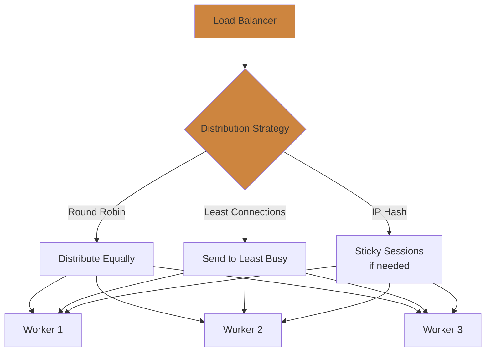

**Distribution Methods:**
- **Round Robin**: Equal distribution (default)
- **Least Connections**: Send to least busy worker
- **IP Hash**: Sticky sessions (if needed, but not required due to stateless design)

### Database Load Distribution

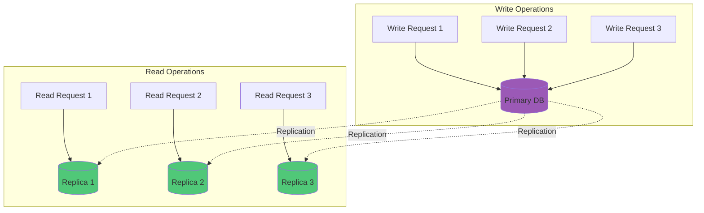

**Read/Write Distribution (Scalable Design - Not Yet Implemented):**
- **Writes**: All to Primary (single source of truth)
- **Reads**: Distributed across Replicas (load balancing)
- **Replication**: Async replication (low latency)
- **Consistency**: Read-after-write uses Primary

**Current Implementation:**
- **All Operations**: Single PostgreSQL database (no replicas)
- **Connection Pooling**: Configured for efficiency
- **Design Ready**: Architecture supports read/write splitting when replicas are added

---

## Data Isolation & Security

### Multi-Tenant Data Isolation

**Three-Layer Isolation:**

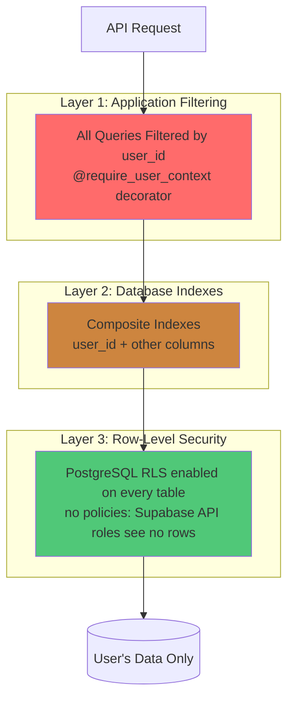

**Isolation Mechanisms:**

1. **Application Level:**
   - All queries include `user_id` filter
   - Decorators enforce user context
   - Input validation prevents injection

2. **Database Level:**
   - Composite indexes on `user_id`
   - Foreign keys with CASCADE
   - Unique constraints per user
   - Row level security on every table and no `anon`/`authenticated` privileges
     (migration 0013), so Supabase's REST API exposes nothing; the backend connects
     as the table owner

3. **API Level:**
   - JWT token contains `user_id`
   - Token validation on every request
   - No cross-user data access possible

### Security Architecture

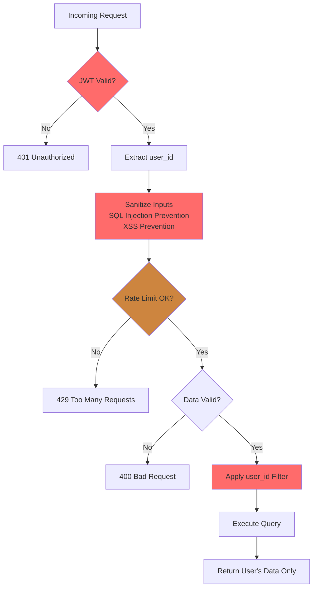

---

## Background Processing Architecture

### Async Processing Design

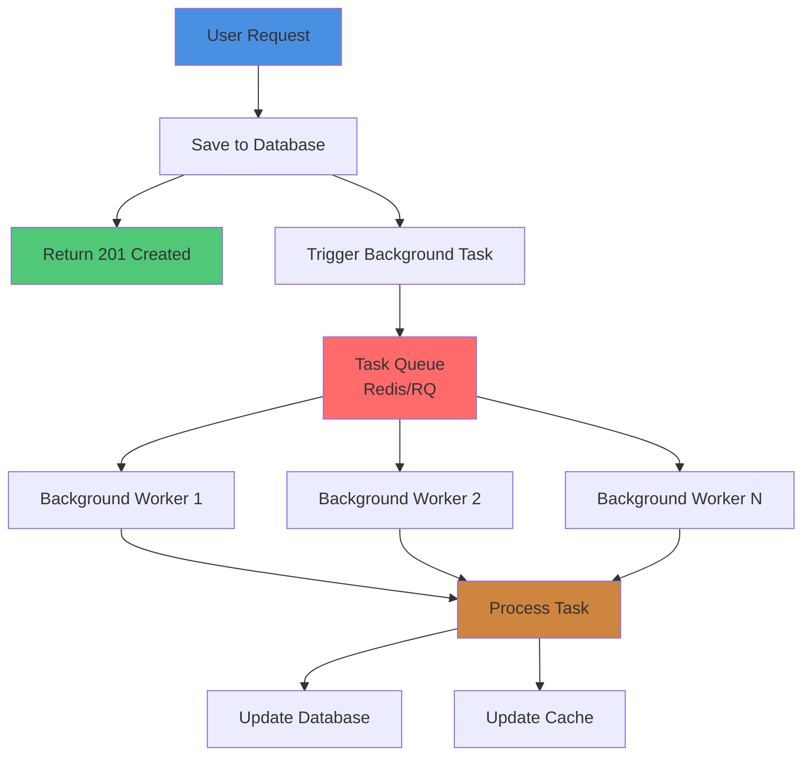

**Background Services (Current Implementation):**

1. **RQ (Redis Queue) Workers** ⭐ **Primary Background System**
   - Location: `backend/worker.py` and `backend/services/task_queue.py`
   - Processes: Bookmark content extraction, embedding generation, analysis
   - Queue System: Redis-based task queue (`default` and `high`)
   - Runs: supervised by supervisord next to Gunicorn (`start.sh` → `supervisord.conf`)
   - Deployment: one `default` and one `high` worker in the same container as the web server

2. **Pipeline Reconciler**
   - Location: `backend/services/pipeline_reconciler.py`
   - Runs: a thread in the `default` worker, every 5 minutes (a Redis lock keeps it to one pass at a time)
   - Re-enqueues: fetches stuck in `PENDING` for 15+ minutes, `FAILED_FETCH` after
     1 h / 6 h / 24 h backoff, and bookmarks that were fetched but never embedded

3. **Content Analysis**
   - Location: `backend/services/background_analysis_service.py` (`analyze_content`)
   - Runs: at the end of the embedding job, skipped when there is no fetched text
   - Uses: the user's own Gemini key, or the shared system key up to
     `SYSTEM_GEMINI_DAILY_LIMIT_PER_USER` uses a day

4. **Cache Invalidation Service**
   - Location: `backend/services/cache_invalidation_service.py`
   - Processes: Cache invalidation on data changes
   - Runs: on a background thread for web requests, inline inside RQ jobs

5. **Import Processing**
   - Location: `backend/blueprints/bookmarks.py`
   - Processes: Bulk bookmark imports (at most 5000 per request)
   - Progress: kept in Redis (`import_progress:{user_id}`) and pushed over SSE

### RQ Worker Architecture

**How It Works:**

```
User Action → API Endpoint → Enqueue Job → Immediate Response
                                      ↓
                              RQ Worker → Process Content → Update Database
```

**Components:**

1. **Task Queue Service** (`backend/services/task_queue.py`)
   - Manages RQ queues and job enqueueing
   - `enqueue_unique()`: one job id per bookmark and stage, so re-enqueueing is always safe
   - Web enqueues use a 5 s socket timeout; workers get a connection without one
     (they block in BLPOP between jobs)
   - Enqueueing never raises: if Redis is down the bookmark stays `PENDING` and the
     reconciler enqueues it later
   - Queue stats read failures from RQ's `FailedJobRegistry`

2. **Bookmark Processing Tasks** (`backend/services/bookmark_processing_service.py`)
   - `process_bookmark_content_task()`: fetches and extracts the page through the
     acquisition engine (official APIs first, then robots.txt, the per-domain rate
     limit and the SSRF-safe fetch). A failed or blocked fetch keeps the user's title
     and notes and is stored as `FAILED_FETCH`, `BLOCKED` or `DISALLOWED`, never as
     content; transient failures (no response, 5xx, 429, over the domain's rate
     limit) raise so RQ retries them
   - `generate_embedding_task()`: enqueued by `PipelineOrchestrator` when a fetch
     completes (backpressure defers it to the reconciler instead of dropping it);
     stores the document embedding, indexes passage chunks, then runs Gemini analysis

3. **RQ Worker** (`backend/worker.py`)
   - Background process that listens to queues and executes tasks
   - Started `with_scheduler=True`, so `Retry(interval=...)` retries actually run
   - Loads the embedding model once in the parent; forked work horses share it
   - `JobTimeoutException` is re-raised through the fetch/Gemini/analysis paths, so
     a timed-out job really fails
   - supervisord gives a running job up to 630 s to finish on shutdown

**Queue Configuration:**

- **Default Queue**: bookmark fetch and embedding jobs, project intent jobs
- **High Priority Queue**: login-triggered cache warming
- **Retry Logic**: fetch jobs 2 retries (after 1 min, then 5 min); project jobs 3
- **Job Timeout**: 10 minutes per job (cache warming: 30 s)

**Current Deployment (Hugging Face Spaces):**

The RQ workers run automatically:
- ✅ `start.sh` migrates the database (and exits if that fails), then execs supervisord
- ✅ supervisord runs Gunicorn plus the `default` and `high` RQ workers in the same Docker container
- ✅ Workers use the same Redis as the web server
- ✅ No manual configuration needed

**Scalable Deployment (Future):**
- Can run RQ workers on separate machines
- Can scale RQ workers independently
- Multiple workers can process jobs in parallel

**Benefits:**
- Non-blocking user requests
- Parallel processing
- User-specific API key usage
- Progress tracking for long operations
- Jobs survive server restarts (persistent queue)
- Automatic retries on failure
- Better scalability (can run workers on separate machines)

---

## ML/AI Architecture

### Embedding Model Architecture

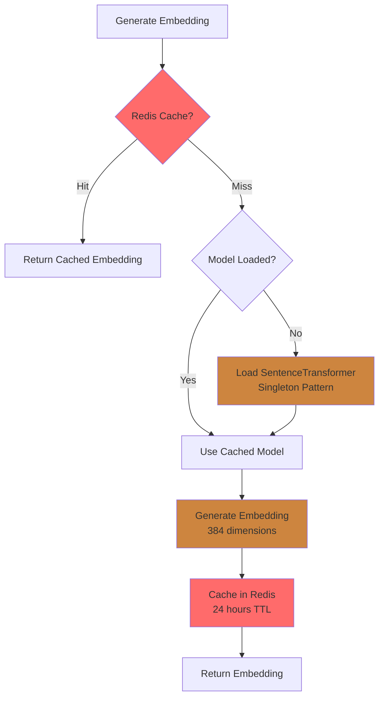

**Model Management:**
- **Model**: `BAAI/bge-small-en-v1.5` (384 dimensions); queries use its query instruction (`embed_query`)
- **Singleton Pattern**: One model instance per process; RQ work horses share the parent's
- **Lazy Loading**: Model loaded on first use (prevents OOM at startup)
- **Thread Safety**: Locking prevents race conditions
- **No Silent Fallback**: if the model can't load, `EmbeddingUnavailable` is raised (embedding
  jobs fail and retry, search returns 503); an encode error raises instead of storing a zero
  vector. Hash vectors exist only as an explicit `DISABLE_EMBEDDINGS` opt-in for local work
- **Redis Caching**: Embeddings cached to avoid regeneration

### Intent × Content Engine

Full design and measurements: [`INTENT_ENGINE_PLAN.md`](INTENT_ENGINE_PLAN.md).

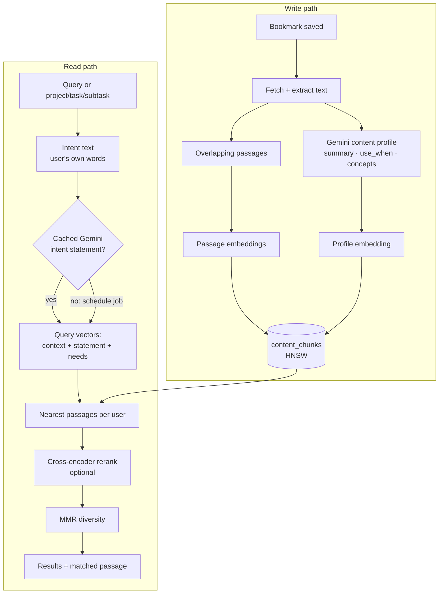

**Properties:**
- **No keyword rules**: retrieval and ranking use embeddings and model judgements only
- **Never blocks on Gemini**: intent statements are computed by a background job and cached per context
- **Fresh results**: result cache keys include a per-user content version that bumps on every change
- **Versioned vectors**: chunks record their embedding model; retrieval only compares vectors from the active model

---

## API Architecture

### Blueprint-Based Modular Design

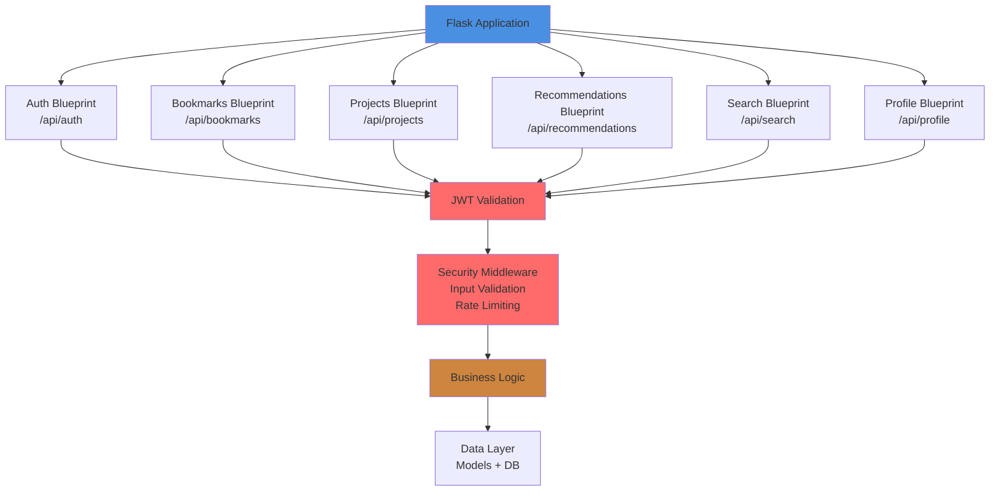

**Blueprint Benefits:**
- **Modularity**: Each feature in separate blueprint
- **Maintainability**: Easy to locate and modify code
- **Testability**: Each blueprint can be tested independently
- **Scalability**: Can split blueprints to separate services if needed

### Request Flow Architecture

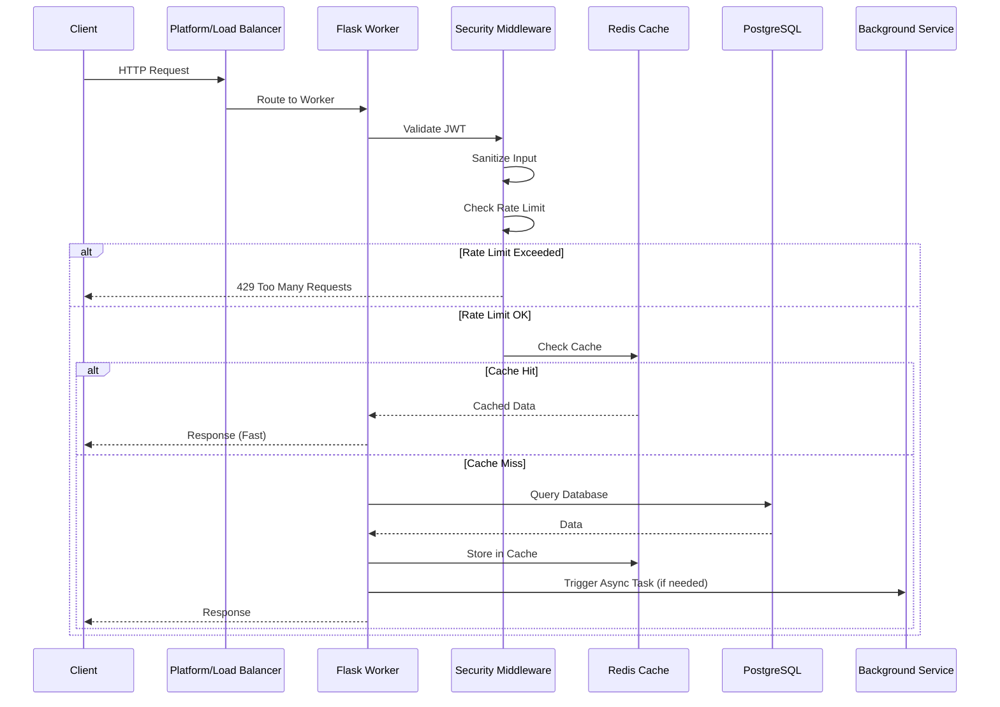

---

## Frontend Architecture

### React Application Structure

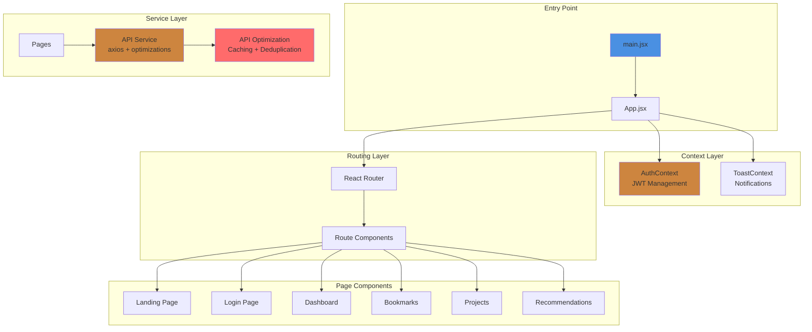

**Frontend Optimizations:**

1. **API Call Optimization**
   - Location: `frontend/src/utils/apiOptimization.js`
   - Features:
     - Request debouncing (300ms)
     - Request batching (50ms window)
     - Response caching (5 minutes TTL)
     - Request deduplication

2. **Code Splitting**
   - React vendor chunk
   - Axios vendor chunk
   - Route-based lazy loading (future)

3. **State Management**
   - React Context for global state
   - Local state for component state
   - No Redux (keeps it simple)

---

## Deployment Architecture

### Current Deployment Stack (What's Actually Running)

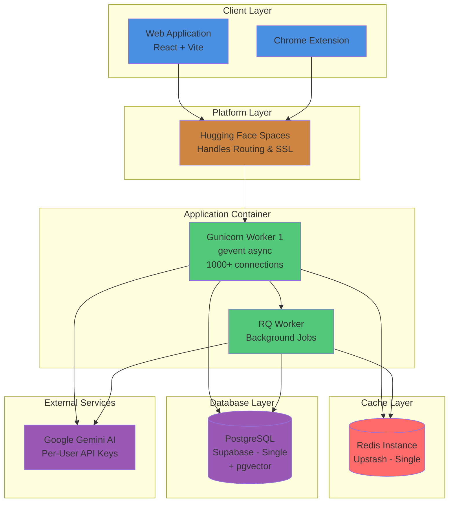

### Scalable Deployment Stack (Future-Ready Design)

```mermaid
graph TB
    subgraph "CDN & Edge"
        CDN[Cloudflare/CDN<br/>Static Assets]
    end
    
    subgraph "Load Balancer"
        LB[Nginx/Cloudflare<br/>SSL Termination<br/>Rate Limiting]
    end
    
    subgraph "Application Servers"
        App1[Gunicorn Worker 1<br/>4 workers]
        App2[Gunicorn Worker 2<br/>4 workers]
        AppN[Gunicorn Worker N<br/>4 workers]
    end
    
    subgraph "Cache Layer"
        Redis[(Redis Cluster<br/>High Availability)]
    end
    
    subgraph "Database Layer"
        Primary[(PostgreSQL Primary<br/>Write Operations)]
        Replica1[(PostgreSQL Replica 1<br/>Read Operations)]
        Replica2[(PostgreSQL Replica 2<br/>Read Operations)]
    end
    
    subgraph "Background Workers"
        BG1[RQ Worker 1]
        BG2[RQ Worker 2]
    end
    
    CDN --> LB
    LB --> App1
    LB --> App2
    LB --> AppN
    
    App1 --> Redis
    App2 --> Redis
    AppN --> Redis
    
    App1 --> Primary
    App2 --> Replica1
    AppN --> Replica2
    
    BG1 --> Redis
    BG2 --> Redis
    BG1 --> Primary
    BG2 --> Primary
    
    Primary -.->|Replication| Replica1
    Primary -.->|Replication| Replica2
    
    style CDN fill:#4a90e2
    style LB fill:#cd853f
    style App1 fill:#50c878
    style Redis fill:#ff6b6b
    style Primary fill:#9b59b6
```

### Current Deployment Configuration

**Application Servers (Current):**
- **Gunicorn Workers**: 2 workers (gevent async, sized for a 2-vCPU host)
- **Worker Class**: gevent (handles 1000+ concurrent connections per worker)
- **Worker Connections**: 1000 per worker
- **Worker timeout**: 60 s (graceful 30 s); psycogreen patch in `post_fork`
- **Deployment target**: single Docker container (Hugging Face Space), deployed only
  after Backend CI passes on that commit
- **Startup**: `start.sh` runs `alembic upgrade head` and refuses to start if it fails
- **Health Checks**: `/health/readiness` (503 unless DB, Redis and the schema at this
  build's Alembic head are ready), `/health/liveness` (Docker `HEALTHCHECK`), and
  `/api/health` (public up/down only)

**Database (Current):**
- **Connection Pool**: 5 base connections, 10 overflow, `pool_pre_ping`, 5 s connect
  timeout, 15 s `statement_timeout`; one engine configured by `UnifiedConfig`
- **Single Database**: All operations to one PostgreSQL instance
- **Schema**: Alembic is the only source of schema; each revision runs in its own transaction
- **Indexes**: defined in the migrations (HNSW for embeddings and passage chunks)

**Redis (Current):**
- **Single Instance**: Upstash (free tier)
- **Shared**: All workers use same Redis
- **Sufficient**: For current scale

**Background Workers (Current):**
- **RQ Workers**: one on `default` (pipeline + reconciler), one on `high` (cache warming)
- **Queue**: Redis as message broker
- **Deployment**: supervisord runs them in the same container as the web server

### Scalable Design Configuration (Future)

**Application Servers (Scalable):**
- **Gunicorn Workers**: 4+ workers per server
- **Threads**: 2 threads per worker (if needed)
- **Auto-scaling**: Based on CPU/memory metrics
- **Multiple Servers**: With load balancer

**Database (Scalable):**
- **Connection Pool**: 5 base connections per worker, 10 overflow
- **Max Overflow**: 10 additional connections
- **Read Replicas**: Scale horizontally
- **Read/Write Splitting**: Writes to primary, reads from replicas

**Redis (Scalable):**
- **Cluster Mode**: For high availability
- **Replication**: Master-replica setup
- **Persistence**: RDB + AOF (if needed)

**Background Workers (Scalable):**
- **RQ Workers**: Multiple workers (separate from web workers)
- **Queue**: Redis as message broker
- **Scaling**: Independent of web workers
- **Note**: Already using RQ (not Celery) - architecture is correct

---

## Scalability Metrics

### Current Capacity (Actual Implementation)

**Current Deployment (Hugging Face Spaces):**
- **Gunicorn**: 2 workers (gevent async, 1000+ connections per worker)
- **Concurrent Users / Requests per second**: not measured yet (a load test will set these)
- **Database Connections**: up to pool_size + max_overflow per process (see docs/OPERATIONS.md)
- **Background Jobs**: RQ workers process ~10-50 jobs/hour
- **Memory Usage**: ~2-4GB of 16GB available (room for growth)

**Current Performance:**
These targets for a scaled-out deployment (replicas, Redis cluster) are design goals, not
measurements; nothing has been load-tested at that scale.

### Scaling Strategy Summary

**Immediate Scaling (Within Current Platform):**
- **Vertical Scaling**: Upgrade HF Spaces hardware (CPU, RAM)
- **Connection Optimization**: Increase gevent workers or connections per worker
- **Database Optimization**: More aggressive caching, query optimization
- **Background Processing**: Multiple RQ workers in same container

**Horizontal Scaling (Future Architecture):**
- **Application Layer**: Add more HF Spaces containers with load balancer
- **Database Layer**: Add PostgreSQL read replicas for read operations
- **Cache Layer**: Redis cluster with sharding across multiple instances
- **Background Workers**: Distributed RQ workers across multiple containers

**Key Scaling Principles:**
- **Stateless Design**: Any worker can handle any request (no session affinity)
- **Shared Nothing**: Redis/DB provide shared state across all instances
- **Connection Pooling**: Efficient database connection management
- **Circuit Breakers**: Graceful degradation when services are unavailable

---

## Key Scalability Features

### 1. Stateless Design
- ✅ No server-side sessions
- ✅ JWT tokens (self-contained)
- ✅ Shared Redis for state
- ✅ Any worker handles any request

### 2. Connection Pooling
- ✅ Efficient database connections
- ✅ Fail-fast timeouts (connect 5 s, statement 15 s)
- ✅ Configurable pool sizes
- ✅ Health checks (pool_pre_ping)

### 3. Caching
- ✅ Redis cache (shared, key builders in `core/cache_keys.py`)
- ✅ Database (persistent)
- ✅ Smart invalidation

### 4. Background Processing
- ✅ Non-blocking operations
- ✅ User-specific API keys
- ✅ Parallel processing
- ✅ Progress tracking

### 5. Database Optimization
- ✅ Comprehensive indexes
- ✅ Read/write splitting (design only; one database today)
- ✅ Connection pooling
- ✅ Query optimization

### 6. User Isolation
- ✅ Complete data separation
- ✅ Per-user rate limits
- ✅ Independent processing
- ✅ Security at all layers

---

Ujjwal Jain


