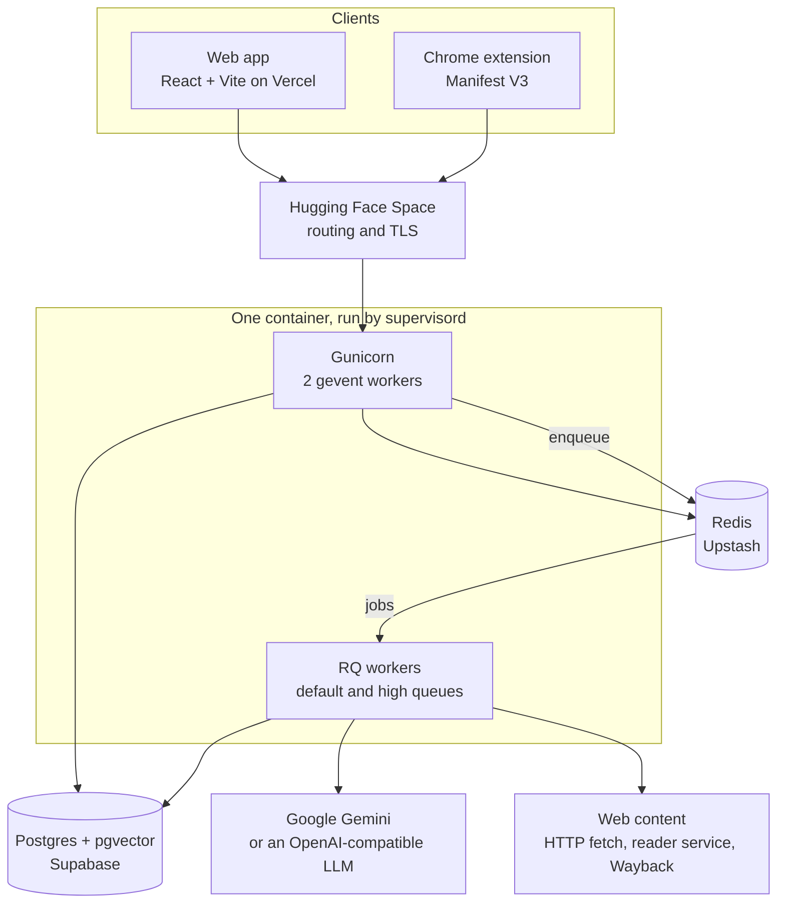
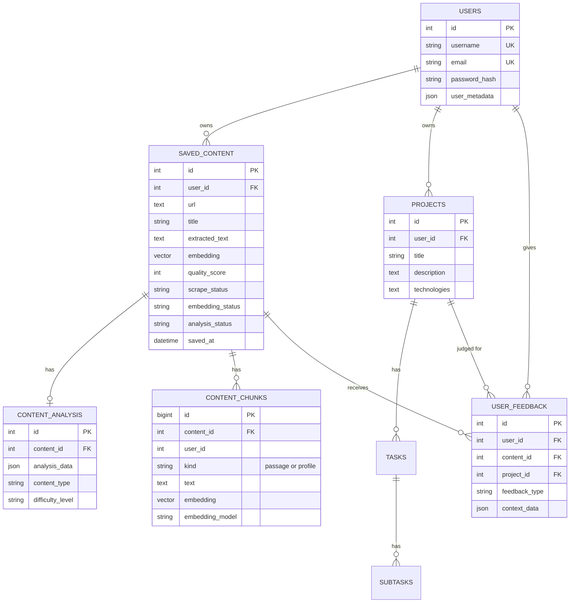
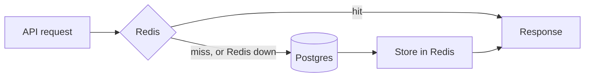
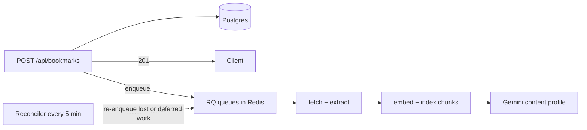
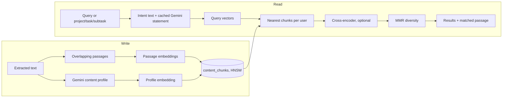
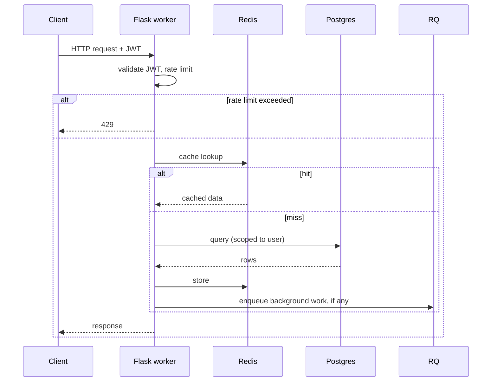

# System Architecture

How Fuze, an intelligent content manager, is put together: what runs, where the data lives, and how a request
or a saved bookmark flows through it.

> [!NOTE]
> **Hosting:** the reference deployment runs the backend on a Hugging Face Space (Docker SDK, free
> `cpu-basic`) with Supabase (Postgres + pgvector) and Upstash (Redis). [`deploy/`](../deploy/README.md)
> holds a self-hosted fallback (Caddy + Docker Compose). The image contains no browser-automation
> tooling (Hugging Face's content policy): our own fetch is plain HTTP, and pages that need a browser
> go to a remote reader service or the Wayback Machine ([`CONTENT_ACQUISITION.md`](CONTENT_ACQUISITION.md)).
> See the root [`README.md`](../README.md).

## Contents

1. [Overview](#overview)
2. [Database](#database)
3. [Caching](#caching)
4. [Statelessness and data isolation](#statelessness-and-data-isolation)
5. [Background processing](#background-processing)
6. [ML/AI](#mlai)
7. [API](#api)
8. [Frontend](#frontend)
9. [Deployment](#deployment)
10. [Scaling beyond one container](#scaling-beyond-one-container)

---

## Overview

Principles:

1. **User isolation.** Every query is scoped to the authenticated user.
2. **Stateless web workers.** No sessions and no per-worker copies of user data; state lives in Redis and
   Postgres.
3. **Shared caching.** Redis holds per-user caches; per-process caches hold only the embedding model, feature
   flags and decrypted API keys.
4. **Background processing.** Fetching, embedding and analysis run in RQ jobs, not in requests.
5. **Bounded resources.** Pooled database connections, per-user and per-IP rate limits, fail-fast timeouts.
6. **Graceful degradation.** Redis is optional on the request path; failed work is retried or re-enqueued by a
   reconciler.

There is no custom load balancer (the platform routes), one Postgres database without replicas, and one Redis.

---

## Database

### Schema

Other tables: `tasks`, `subtasks`, `bookmark_metadata`, `bookmark_events`, `token_families`. Alembic
(`backend/alembic/versions/`) is the only source of schema; `start.sh` runs `alembic upgrade head` before
anything serves traffic and refuses to start if it fails.

### Indexes

Defined in the models and migrations; the ones that matter most:

- **User scoping:** `saved_content (user_id, saved_at)`, `(user_id, quality_score)`; `projects (user_id, created_at)`;
  `tasks (project_id, created_at)`; `content_chunks (user_id, embedding_model)`; unique `(user_id, url)` on
  `saved_content`.
- **Vectors (pgvector HNSW, cosine, `m = 16`, `ef_construction = 64`):** `content_chunks.embedding` and
  `saved_content.embedding`. `hnsw.iterative_scan` and `hnsw.ef_search` are set as database or role defaults
  (migrations `0015`, `0017`) so a per-user filter still returns enough rows.
- **Text search:** a `tsvector` index and a trigram index on `saved_content` (migration `0014`); a GIN index on
  `bookmark_metadata.jsonb_payload`.
- **Case-insensitive lookup:** `lower(username)` and `lower(email)` on `users`.

### Connection pooling

One SQLAlchemy engine per process, configured by `utils/unified_config.py` (the `DB_*` variables in
`.env.example`):

| Setting | Web workers | RQ workers |
|---|---|---|
| `pool_size` | 5 (`DB_POOL_SIZE`) | 2 (`DB_WORKER_POOL_SIZE`) |
| `max_overflow` | 5 (`DB_MAX_OVERFLOW`) | 1 (`DB_WORKER_MAX_OVERFLOW`) |

Also: `pool_recycle` 300 s, `pool_timeout` 20 s, connect timeout 5 s, `statement_timeout` 15 s (set per
connection, so it works through Supabase's pooler), `sslmode=require` in production, and a ping only after a
connection has been idle (`DB_PING_IDLE_SECONDS`, default 15; `utils/db_pool.py`). All processes share the
pooler's connection limit; see the budget in [OPERATIONS.md](OPERATIONS.md).

---

## Caching

- **In process:** the embedding model instance (a singleton), feature flags (5 s TTL) and decrypted user API
  keys. User data is never cached per worker.
- **Redis** (`utils/redis_utils.py`, `RedisCache`). Every per-user key is built in `core/cache_keys.py`, so
  readers and invalidators cannot drift apart:
  - per-user pages: `profile:{id}`, `dashboard:v1:summary:{id}` (30 s), `dashboard:stats:{id}`,
    `bookmarks:{id}:{page}:{per_page}:{search}:{category}` (5 min, 1 min for a search), `bookmarks:{id}:list`,
    `projects:{id}:{page}:{per_page}:{include_tasks}`;
  - recommendation results (10 min), keyed by a per-user content version that changes on every save, edit and
    delete, so stale results are never served;
  - embeddings, keyed by a hash of model and text, 24 h TTL;
  - Gemini analysis results, `content_analysis:{content_id}`.
- Redis is optional on the request path: 2 s socket timeouts, no `PING` per operation, and at most one
  reconnect attempt every 5 s while it is down.
- **Invalidation** (`services/cache_invalidation_service.py`) uses the same key builders and wildcard patterns.
  Web requests invalidate on a background thread; RQ jobs invalidate inline, because work horses exit with
  `os._exit()` and would kill the thread first. `DELETE /api/bookmarks/all` clears synchronously.

Measured effects of caching and of the other latency work are in [OPTIMIZATIONS.md](OPTIMIZATIONS.md).

---

## Statelessness and data isolation

Authentication is a JWT (Flask-JWT-Extended); there are no server-side sessions, so any worker can serve any
request. Isolation has three layers:

1. **Application.** Every query filters on the `user_id` taken from the verified token, never from the
   request body.
2. **Database.** Foreign keys cascade on delete, `saved_content` is unique per `(user_id, url)`, and indexes lead
   with `user_id`. Vector queries are filtered by `user_id` in the same statement as the HNSW search.
3. **Row-level security.** Migration `0013` enables RLS on every table and removes `anon` and `authenticated`
   privileges, so Supabase's REST API exposes nothing; the backend connects as the table owner.

Per-user and per-IP rate limits use Flask-Limiter with Redis (`middleware/rate_limiting.py`).

---

## Background processing

- **RQ workers** (`backend/worker.py`, `services/task_queue.py`): one on `default`, one on `high`, supervised by
  `supervisord.conf` next to Gunicorn. Each loads the embedding model in the parent process before forking so
  work horses share it.
- **Jobs.** `enqueue_unique()` uses one job id per bookmark and stage, so re-enqueueing is safe. Fetch jobs
  (`default`) retry twice (after 1 min, then 5 min); embedding jobs and login-triggered cache warming run on
  `high`, so a fetched bookmark becomes searchable without waiting behind a bulk import. Project intent jobs
  retry three times. Job timeout is 10 minutes (cache warming 30 s). Enqueueing never raises: if Redis is down
  the bookmark stays `PENDING` and the reconciler enqueues it later. Web enqueues use a 5 s socket timeout.
- **Pipeline stages** are recorded on the row (`scrape_status`, `embedding_status`, `analysis_status`).
  `process_bookmark_content_task` fetches through the acquisition engine
  ([CONTENT_ACQUISITION.md](CONTENT_ACQUISITION.md)). A failed or blocked fetch keeps the user's title and
  notes and is stored as `FAILED_FETCH`, `BLOCKED` or `DISALLOWED`, never as content; transient failures raise so
  RQ retries them. `generate_embedding_task` stores the document embedding, indexes passage chunks, and runs the
  Gemini analysis (the user's own key, or the shared system key up to `SYSTEM_GEMINI_DAILY_LIMIT_PER_USER` uses a
  day).
- **Reconciler** (`services/pipeline_reconciler.py`): a thread in the `default` worker, one pass every 5 minutes
  under a Redis lock. It re-enqueues fetches stuck in `PENDING` for 15+ minutes, retries `FAILED_FETCH` after
  1 h, 6 h and 24 h, re-enqueues bookmarks fetched but never embedded, and moves due retries back onto their
  queues. There is no RQ scheduler; this keeps idle Redis traffic low (see OPERATIONS.md, Redis command budget).
- **Bulk import** (`blueprints/bookmarks.py`): at most 5000 items per request; progress is kept in Redis
  (`import_progress:{user_id}`) and pushed over Server-Sent Events (`blueprints/events.py`).
- supervisord gives a running job up to 630 s to finish on shutdown.

---

## ML/AI

### Embeddings

- Model: `BAAI/bge-small-en-v1.5`, 384 dimensions; queries use the model's query instruction (`embed_query`).
- One model instance per process, loaded lazily on first use; RQ parents preload it.
- No silent fallback: if the model cannot load, `EmbeddingUnavailable` is raised (embedding jobs fail and retry,
  search returns 503), and an encode error raises instead of storing a zero vector. Hash vectors exist only as the
  explicit `DISABLE_EMBEDDINGS` opt-in for local work.
- Every stored vector records its model; retrieval compares only vectors from the active model.

### Recommendations and search

Recommendations come from the intent x content engine (`backend/ml/intent_engine/`); search uses the same
passage retrieval. How it works, how it is evaluated and what it scored: [RECOMMENDATIONS.md](RECOMMENDATIONS.md),
[ADR-007](adr/ADR-007-intent-engine.md).

---

## API

Flask blueprints, all behind JWT validation, input validation and rate limiting:

| Blueprint | Prefix |
|---|---|
| auth, account, user_api_key | `/api/auth`, `/api/account`, `/api/user` |
| bookmarks | `/api/bookmarks` |
| projects, tasks | `/api/projects`, `/api/tasks` |
| recommendations, feedback | `/api/recommendations` |
| search, ask | `/api/search`, `/api/ask` |
| dashboard, profile, events (SSE) | `/api/dashboard`, `/api`, `/api` |
| linkedin | registered when available |

Health: `/health/liveness` (no dependencies; the Docker `HEALTHCHECK`), `/health/readiness` (503 unless the
database, Redis and a schema at this build's Alembic head are ready), and `/api/health` (public up/down only).
Endpoint details: [API_ARCHITECTURE.md](API_ARCHITECTURE.md).

---

## Frontend

React 19 with Vite, Tailwind CSS and React Router (`frontend/src`).

- **State:** React context (`AuthContext`, `ToastContext`, `SidebarContext`) and local component state; no Redux.
- **Pages:** Landing, Login, OAuthCallback, Dashboard, Bookmarks, SaveContent, ShareHandler, Projects,
  ProjectDetail, Recommendations, Ask, Profile, ExtensionDownload (`src/pages`).
- **API client:** `src/services/api.js` (axios). Access and refresh tokens are kept in `localStorage`; concurrent
  401s share one refresh request. `src/services/realtime.js` consumes the SSE stream for import progress.
- **Build:** most pages are loaded with `React.lazy`; Vite splits vendor and page chunks
  (`frontend/vite.config.js`).
- **PWA:** service worker and web app manifest with a share target ([PWA.md](PWA.md)).
- The Chrome extension (`BookmarkExtension/`, Manifest V3) saves bookmarks through the same API.

---

## Deployment

Hugging Face Space, one Docker container started by `start.sh`: migrate (exit on failure), then `supervisord`
runs:

- **Gunicorn** (`gunicorn.conf.py`): 2 workers, `worker_class = "gevent"`, 1000 connections per worker,
  `timeout = 60`, `graceful_timeout = 30`, `preload_app = False` (each worker opens its own DB and Redis
  connections after fork). `post_fork` calls `psycogreen.patch_psycopg()` so Postgres waits yield, and sets one
  torch thread per worker; CPU-bound work (query embedding, bcrypt) runs on gevent's thread pool
  (`utils/cooperative.py`).
- **RQ workers** for the `default` and `high` queues.

The Space deploys only after Backend CI passes on that commit. The frontend is deployed on Vercel. Backups,
rollback, secrets, keep-alives and the database connection budget are in [OPERATIONS.md](OPERATIONS.md);
platform steps are in [DEPLOYMENT.md](DEPLOYMENT.md).

---

## Scaling beyond one container

Not implemented; the design leaves room for it:

- **More web capacity:** workers are stateless, so more containers behind a load balancer need no code change.
  Each process adds to the pooler's connection count, so lower the pool settings accordingly.
- **RQ workers** can run in separate containers against the same Redis.
- **Reads:** a single Postgres serves reads and writes today; read replicas would need read/write routing in the
  data layer, which does not exist.
- **Latency:** the largest measured cost is the round trip between the Space and the database region
  ([perf/README.md](perf/README.md), [REGION_MOVE.md](REGION_MOVE.md)), not CPU.
