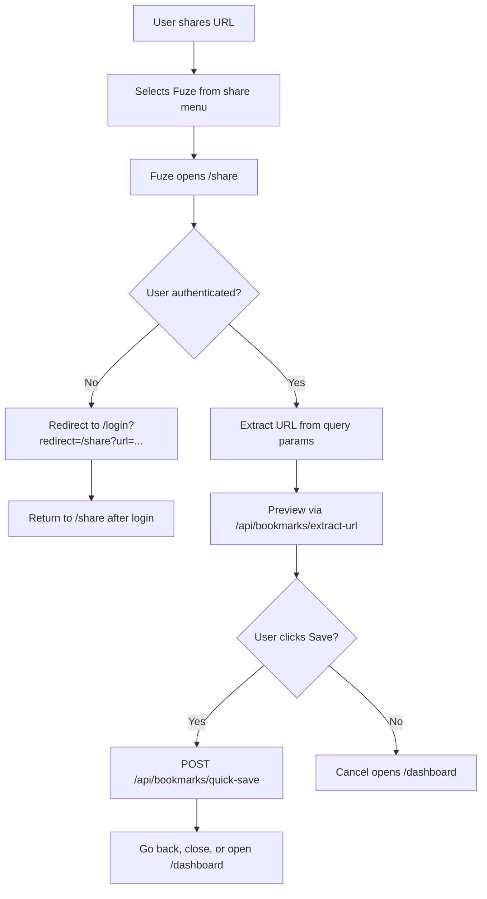

# PWA (Progressive Web App) Guide

How the Fuze web app installs as a Progressive Web App, how its service worker behaves,
how the share target works, and how to test them.

## Table of Contents

1. [Overview](#overview)
2. [Implementation](#implementation)
3. [Share Functionality](#share-functionality)
4. [Testing Guide](#testing-guide)
5. [Troubleshooting](#troubleshooting)
6. [Browser Compatibility](#browser-compatibility)
7. [Production Checklist](#production-checklist)

---

## Overview

The web app ships a manifest and a service worker, so browsers can install it as a
standalone app on desktop and mobile. It provides:

- **Installability**: a web app manifest (`display: standalone`) and icons
- **Share target**: URLs shared from other apps open Fuze's `/share` page
- **Faster repeat loads**: the service worker caches the app shell and hashed static assets
- **Offline shell**: with no network, navigations fall back to the cached app shell. Data
  comes from the API, which is never cached, so lists and searches need a connection

Install is done from the browser (address-bar install icon or the menu). The app calls
`preventDefault()` on `beforeinstallprompt`, which suppresses the browser's automatic
install banner, and it has no install button of its own.

---

## Implementation

### Files

```
frontend/
├── public/
│   ├── manifest.json        # PWA manifest
│   ├── sw.js                # Service worker
│   ├── logo1.svg            # The wordmark (in-app logo)
│   └── icons/               # Square PNG icons (192, 512, maskable 512, apple-touch 180)
├── src/
│   ├── main.jsx             # Service worker registration, install-prompt listeners
│   └── pages/
│       └── ShareHandler.jsx # /share page
├── vite.config.js           # Replaces __BUILD_HASH__ in dist/sw.js at build time
├── vercel.json              # Headers for /sw.js and /manifest.json
└── index.html               # Manifest link, theme-color, apple-touch-icon (PNG)
```

### Manifest

**File**: `frontend/public/manifest.json`

```json
{
  "name": "Fuze - Smart Content Analysis & Recommendations",
  "short_name": "Fuze",
  "description": "AI-powered content analysis, LinkedIn post extraction, and personalized recommendations",
  "start_url": "/",
  "display": "standalone",
  "background_color": "#0F0F1E",
  "theme_color": "#4DD0E1",
  "orientation": "portrait-primary",
  "scope": "/",
  "id": "/",
  "lang": "en",
  "categories": ["productivity", "education", "business"],
  "icons": [
    { "src": "/icons/icon-192.png", "sizes": "192x192", "type": "image/png", "purpose": "any" },
    { "src": "/icons/icon-512.png", "sizes": "512x512", "type": "image/png", "purpose": "any" },
    { "src": "/icons/maskable-512.png", "sizes": "512x512", "type": "image/png", "purpose": "maskable" },
    { "src": "/logo1.svg", "sizes": "any", "type": "image/svg+xml", "purpose": "any" }
  ],
  "share_target": {
    "action": "/share",
    "method": "GET",
    "enctype": "application/x-www-form-urlencoded",
    "params": { "title": "title", "text": "text", "url": "url" }
  }
}
```

The icons are real PNGs, drawn from the lightning bolt in the logo by `scripts/make_pwa_icons.py` (`logo1.svg`
is a wide wordmark and makes a poor square icon). Android Chrome needs PNGs at 192 and 512 before it installs the
app as a WebAPK, and only an installed app is listed in the phone's share sheet, so this is what makes "share a
LinkedIn post to Fuze" possible. The maskable icon has its own file with the bolt inside the safe zone, and each icon
has one `purpose`. `index.html` also sets `theme-color` to `#4DD0E1` and a PNG `apple-touch-icon` (iOS ignores an
SVG one). iOS does not support the Web Share Target at all, so a share from an iPhone cannot open the app.

### Service Worker

**File**: `frontend/public/sw.js`. It handles same-origin GET traffic only, and does
nothing else (no push notifications, no background sync, no offline write queue).

| Request | Strategy |
|---------|----------|
| Cross-origin | Not intercepted |
| `/api/*` | Not intercepted: always goes to the network |
| `/oauth/callback`, `/auth/callback`, `/login` | Network only, never cached |
| Navigations (`request.mode === 'navigate'`) | Network first. A successful response is stored as `/index.html` and under the request; if the network fails, the cached `/index.html` is served, or a plain 503 "Offline mode" response if there is none |
| `/assets/*` and files ending in `.js .css .woff .woff2 .png .jpg .jpeg .svg .ico .webp .gif` | Cache first. Only `basic` 200 responses with a matching content type (never HTML) are stored; the asset cache keeps at most 120 entries, trimming the oldest |

Other details:
- **Precache**: `/index.html` and `/manifest.json` on install, then `skipWaiting()`.
- **Versioning**: the cache names are `shell-<hash>` and `assets-<hash>`. `vite.config.js`
  replaces the `__BUILD_HASH__` placeholder in `dist/sw.js` with a base-36 timestamp on
  each build, and the service worker deletes caches from other versions on activate and
  then claims clients.
- **Registration** (`src/main.jsx`): on window load the app checks that `/sw.js` is
  reachable, registers it, checks for an update every 60 seconds, and reloads the page
  when a new worker finishes installing while an old one controls the page.
- **Headers** (`vercel.json`): `/sw.js` is served as JavaScript with
  `Cache-Control: public, max-age=0, must-revalidate` and `Service-Worker-Allowed: /`. Vercel applies every
  matching rule and a later one overrides an earlier one, so the `/sw.js` and `/manifest.json` rules must stay
  **after** the generic `*.js` and `*.json` rules; with them first, the "`*.js` is immutable for a year" rule won and
  the worker was served as immutable. `src/tests/pwa.test.js` pins the order.

### Share Handler

**File**: `frontend/src/pages/ShareHandler.jsx`, routed at `/share` in `src/App.jsx`
(outside `ProtectedRoute`: the page itself redirects when signed out).

- Reads `url`, `title` and `text` from the query string. If `url` is empty it looks for a
  URL inside `text` or `title`, including long LinkedIn feed URLs and `lnkd.in` links
- When signed in, asks `POST /api/bookmarks/extract-url` for a preview
- Saves with `POST /api/bookmarks/quick-save` (`url`, `title`, `description`)
- When signed out, redirects to `/login?redirect=/share?url=...`; the login page honors
  `?redirect=` for internal paths
- After a successful save it shows a confirmation, then goes back in history or closes
  the window; if neither works it navigates to `/dashboard`. Cancel goes to `/dashboard`

---

## Share Functionality

### How It Works

1. The user shares a URL from another app or a browser
2. Selects "Fuze" from the share menu (available once the PWA is installed)
3. Fuze opens at `/share` with `title`, `text` and `url` query parameters
4. The URL is extracted and previewed
5. The user saves the bookmark with one click

The saved bookmark goes through the normal pipeline (scrape, embed, analyze) like any
other quick save.

### Share Handler Flow



---

## Testing Guide

### Prerequisites

1. **HTTPS**: PWAs require HTTPS (localhost is exempt)
2. **Installed PWA**: the share target only appears once the app is installed
3. **A mobile device** (Android recommended) for the share tests

Replace `https://<your-host>` below with the address the frontend is served from.

### Test 1: Service Worker Registration

1. Open `https://<your-host>` in Chrome
2. DevTools → Application → Service Workers

Expected: the worker is "activated and is running", scope `https://<your-host>/`, no
console errors. Under Application → Cache Storage there are `shell-*` and `assets-*`
caches.

### Test 2: Installation (Desktop)

1. Open the site in Chrome or Edge
2. Use the install icon in the address bar, or the browser menu → Install

Expected: the app opens in a standalone window without browser UI.

### Test 3: Installation (Android)

1. Open the site in Chrome on Android
2. Menu → "Install app" / "Add to Home screen"

Expected: an icon on the home screen; the app opens in standalone mode.

### Test 4: Installation (iOS)

1. Open the site in Safari
2. Share → "Add to Home Screen"

Expected: an icon on the home screen; the app opens in standalone mode. The Web Share
Target API is not supported by iOS Safari, so sharing into Fuze does not work there.

### Test 5: Share Target (Android)

1. Install the PWA
2. In another app or browser, share a page and pick "Fuze"

Expected: Fuze opens at `/share`, shows the URL, and saves the bookmark. You can also test
without a phone: open `/share?url=https://example.com` directly.

### Test 6: Offline Behaviour

1. Load the app and visit a few pages while online
2. Go offline (DevTools → Network → Offline)
3. Reload or navigate

Expected: the app shell loads from the cache and API calls fail with an error message.
Data that was not already on screen is not available, because API responses are not cached.

### Test 7: Edge Cases

- **No URL**: open `/share` with no parameters. The page reports that no URL was provided
- **Not signed in**: open `/share?url=...` while logged out. You are sent to the login
  page and returned to `/share` after signing in
- **Network failure**: the save error is shown and Save can be retried

---

## Troubleshooting

### Service Worker Not Registering

- Verify `sw.js` exists in `frontend/public/` and in the build output (`dist/sw.js`)
- Verify it is reachable at `/sw.js` and returns JavaScript, not the SPA's HTML fallback
- Check the console for "Service Worker not available"

### Stale Assets After a Deploy

- Each build gets a new cache version, and an update check runs every 60 seconds; the page
  reloads when the new worker installs. If a build did not replace `__BUILD_HASH__`
  (see the build log line "Service worker version injected"), the old caches are kept
- Unregister the worker in DevTools and reload

### API Calls Failing Through the Service Worker

The worker does not intercept `/api/` or cross-origin requests, so API failures are
network or backend problems. If they only happen with the worker active, unregister it and
retest.

### Install Option Not Appearing

- Verify `manifest.json` is valid and served over HTTPS
- Check whether the app is already installed
- Try a private window
- Remember the app has no in-page install button; use the browser's own install control

### Share Target Not Working

- Confirm `share_target` is in the served `manifest.json` and the PWA was reinstalled after
  it changed
- Test on Android (iOS does not support it)
- Test the route with `/share?url=https://example.com`

---

## Browser Compatibility

The Web Share Target API requires an installed PWA in a Chromium-based browser on Android
(Chrome, Edge, Samsung Internet). It is not available in Safari on iOS or in Firefox for
Android. Installation itself works on desktop Chrome and Edge, Android Chrome, and iOS Safari
("Add to Home Screen").

---

## Production Checklist

- [ ] `/manifest.json` is accessible and valid
- [ ] `/sw.js` is served as JavaScript with `Cache-Control: max-age=0, must-revalidate`
- [ ] The service worker registers and activates
- [ ] `__BUILD_HASH__` was replaced in the built `sw.js`
- [ ] `/share` loads and the sign-in redirect returns to it
- [ ] HTTPS is enabled

---

## Additional Resources

- [Web Share Target API Documentation](https://web.dev/web-share-target/)
- [PWA Best Practices](https://web.dev/pwa-checklist/)
- [Manifest.json Reference](https://developer.mozilla.org/en-US/docs/Web/Manifest)
- [Service Worker API](https://developer.mozilla.org/en-US/docs/Web/API/Service_Worker_API)
