# User Flow Documentation

Complete user journey and system flows for Fuze - Intelligent Bookmark Manager.

## Table of Contents

1. [Complete User Onboarding Flow](#complete-user-onboarding-flow)
2. [API Key Setup Flow](#api-key-setup-flow)
3. [Bookmark Saving Flow](#bookmark-saving-flow)
4. [Chrome Extension Import Flow](#chrome-extension-import-flow)
5. [Content Analysis Flow](#content-analysis-flow)
6. [Recommendation Generation Flow](#recommendation-generation-flow)
7. [Project-Based Recommendations Flow](#project-based-recommendations-flow)
8. [Search Flow](#search-flow)
9. [LinkedIn Integration Flow](#linkedin-integration-flow)
10. [Extension Authentication Flow](#extension-authentication-flow)
11. [Task Management Flow](#task-management-flow)

---

## Complete User Onboarding Flow

This diagram shows the complete journey from landing page to fully set up account.

```mermaid
flowchart TD
    Start([User visits Landing Page]) --> Landing{User Authenticated?}
    Landing -->|No| ViewLanding[View Landing Page Features]
    Landing -->|Yes| Dashboard[Redirect to Dashboard]
    
    ViewLanding --> ClickSignup[Click 'Start for Free']
    ClickSignup --> LoginPage[Login Page - Signup Mode]
    
    LoginPage --> FillForm[Fill Registration Form]
    FillForm --> ValidateForm{Form Valid?}
    ValidateForm -->|No| ShowErrors[Show Validation Errors]
    ShowErrors --> FillForm
    
    ValidateForm -->|Yes| CheckUsername[Check Username Availability]
    CheckUsername --> UsernameAvailable{Available?}
    UsernameAvailable -->|No| ShowSuggestions[Show Username Suggestions]
    ShowSuggestions --> FillForm
    
    UsernameAvailable -->|Yes| SubmitRegistration[POST /api/auth/register]
    SubmitRegistration --> CreateUser[Create User Account]
    CreateUser --> GenerateToken[Generate JWT Token]
    GenerateToken --> SetOnboarding[Set show_onboarding = true]
    SetOnboarding --> RedirectDashboard[Redirect to Dashboard]
    
    RedirectDashboard --> CheckOnboarding{Onboarding Modal?}
    CheckOnboarding -->|Yes| OnboardingStep1[Step 1: API Key Setup]
    CheckOnboarding -->|No| DashboardView[View Dashboard]
    
    OnboardingStep1 --> HasAPIKey{Has API Key?}
    HasAPIKey -->|No| ShowAPIKeyInstructions[Show Gemini API Key Instructions]
    ShowAPIKeyInstructions --> UserAddsKey[User adds API key in Profile]
    UserAddsKey --> SaveAPIKey[Save API Key to Database]
    SaveAPIKey --> OnboardingStep2
    
    HasAPIKey -->|Yes| OnboardingStep2[Step 2: Install Extension]
    OnboardingStep2 --> ShowExtensionInstructions[Show Extension Installation Guide]
    ShowExtensionInstructions --> UserInstallsExtension[User installs Chrome Extension]
    UserInstallsExtension --> ExtensionLogin[Extension: Login with Credentials]
    ExtensionLogin --> SyncToken[Sync Auth Token to Extension]
    SyncToken --> OnboardingStep3
    
    OnboardingStep3[Step 3: Import Bookmarks] --> ShowImportInstructions[Show Import Instructions]
    ShowImportInstructions --> UserClicksImport[User clicks 'Import All Bookmarks']
    UserClicksImport --> ImportFlow[Start Import Flow]
    ImportFlow --> OnboardingComplete[Mark Onboarding Complete]
    
    OnboardingComplete --> DashboardView
    DashboardView --> End([User Ready to Use Fuze])
    
    style Start fill:#4a90e2
    style End fill:#50c878
    style OnboardingStep1 fill:#cd853f
    style OnboardingStep2 fill:#cd853f
    style OnboardingStep3 fill:#cd853f
```

---

## API Key Setup Flow

This shows how users set up their Gemini API key for AI-powered features.

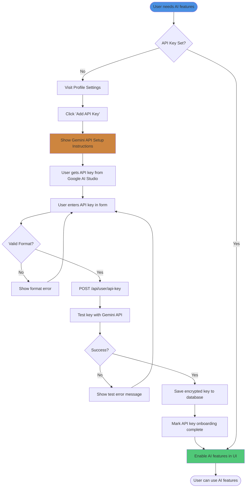

**Key Features**:
- API key encryption at rest
- Per-user key isolation
- Rate limiting per user
- Automatic key validation
- Without a key, users share the system key up to `SYSTEM_GEMINI_DAILY_LIMIT_PER_USER` uses a day (default 30); after that they're asked to add a key and background analysis waits

---

## Bookmark Saving Flow

This shows how bookmarks are saved from the extension or web interface.

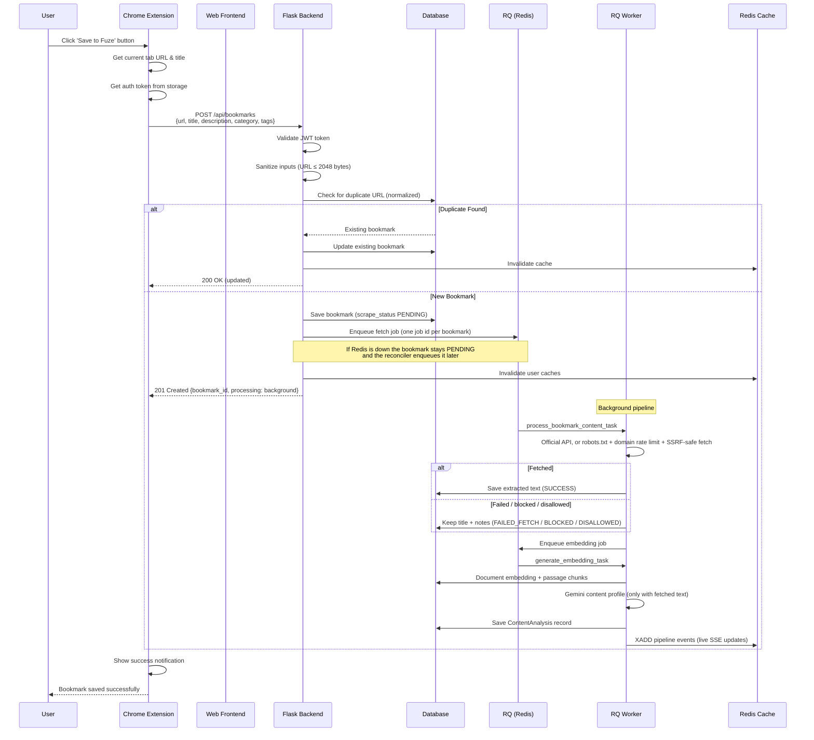

---

## Chrome Extension Import Flow

Complete flow for importing all Chrome bookmarks.

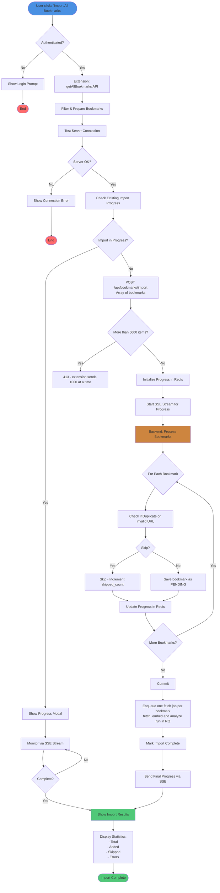

---

## Content Analysis Flow

Analysis of saved bookmarks using Gemini AI. It runs at the end of the embedding job
in the RQ worker, not on a polling thread.

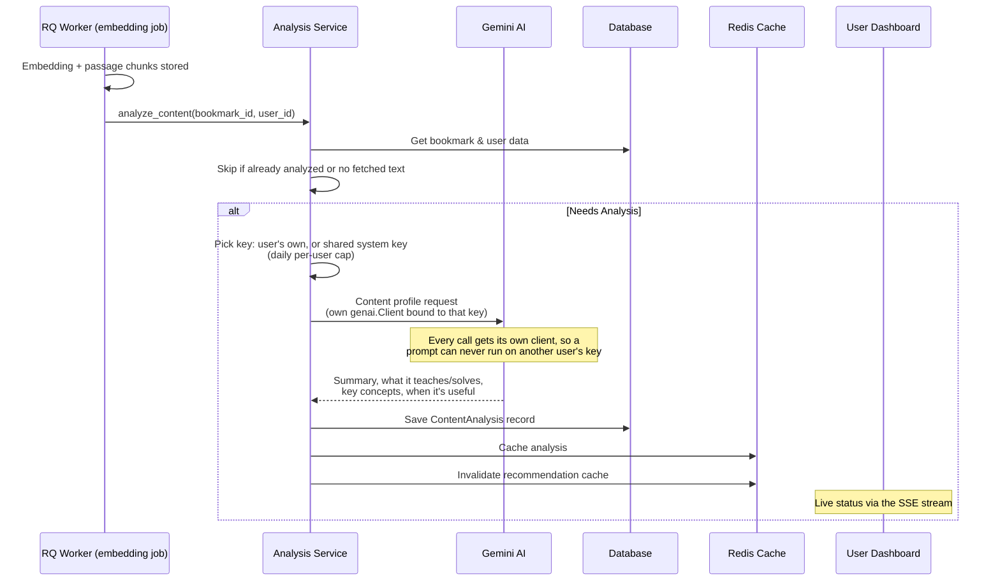

---

## Recommendation Generation Flow

Complete flow for generating AI-powered recommendations.

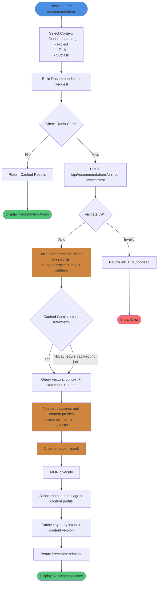

---

## Project-Based Recommendations Flow

Recommendations specific to a project context.

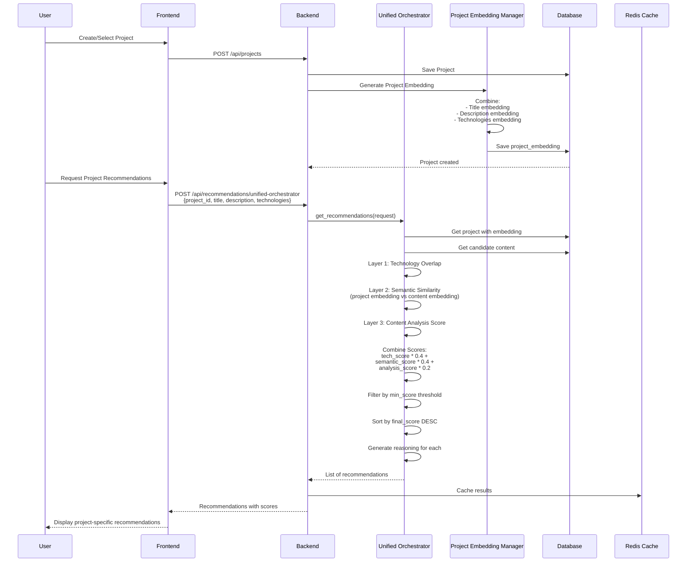

---

## Search Flow

Semantic and text-based search functionality.

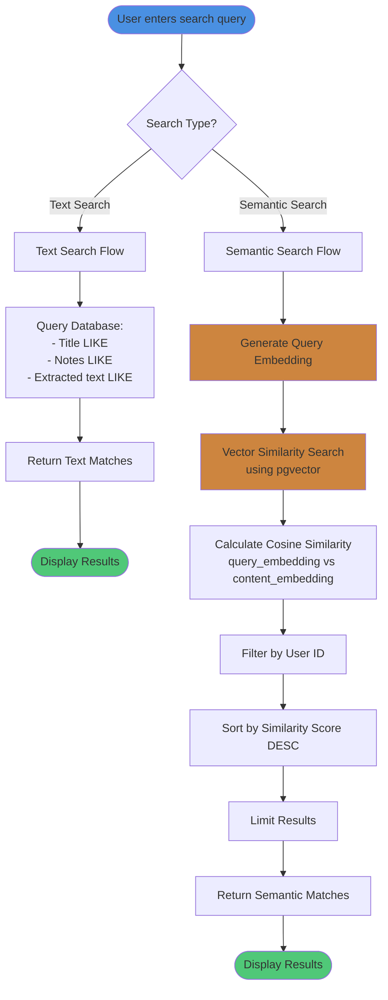

---

## LinkedIn Integration Flow

This shows how users extract and analyze LinkedIn content.

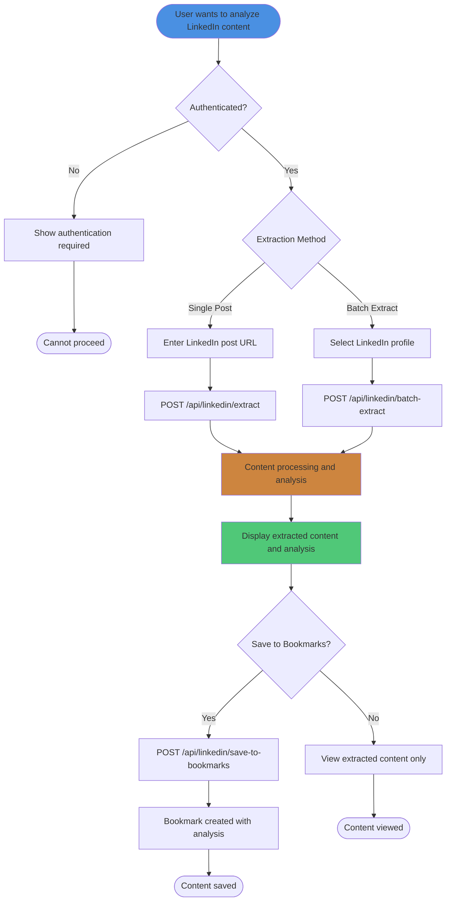

**Features**:
- Single post extraction
- Batch profile extraction
- Content analysis with AI
- Save to bookmarks integration
- Extraction history tracking

---

## Task Management Flow

This shows how users create and manage project tasks with AI assistance.

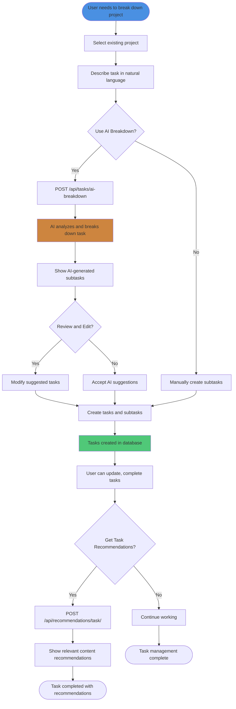

**Features**:
- AI-powered task breakdown
- Manual task creation
- Subtask management
- Task-based recommendations
- Progress tracking

---

## Extension Authentication Flow

How the Chrome extension authenticates and syncs with the web platform.

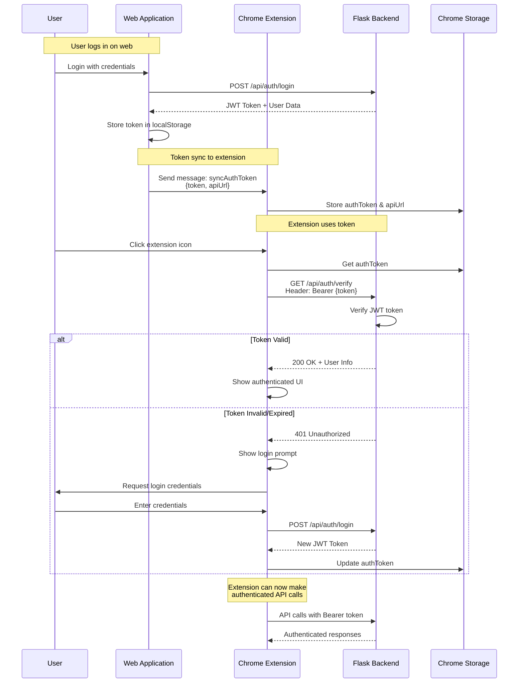

---

## Complete System Architecture Flow

High-level view of how all components interact.

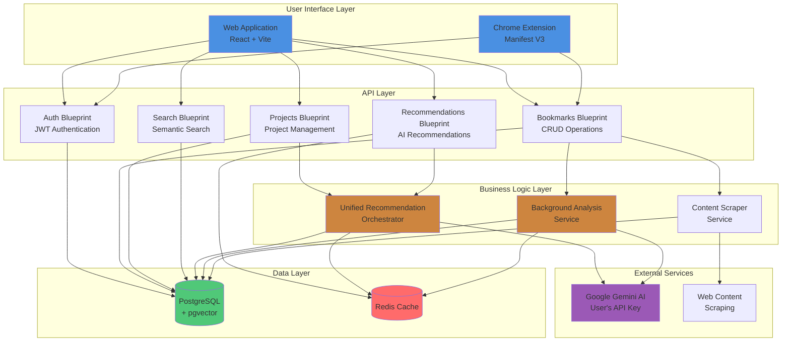

---

## Key User Journeys Summary

### Journey 1: New User Onboarding
1. Visit landing page → Sign up → Set API key → Install extension → Import bookmarks → Start using

### Journey 2: Saving a Bookmark
1. Browse web → Click extension → Save bookmark → Content extracted → Background analysis → Ready for recommendations

### Journey 3: Getting Recommendations
1. Go to Recommendations page → Select context → Request recommendations → View personalized results → Save useful ones

### Journey 4: Project-Based Learning
1. Create project → Add tasks → Get project recommendations → Save relevant content → Track progress

### Journey 5: Content Discovery
1. Use semantic search → Find related content → View recommendations → Discover new resources

---

## Notes

- **Background Processing**: Content analysis runs asynchronously to avoid blocking user requests
- **Caching Strategy**: Multiple layers of caching (Redis, query cache, recommendation cache) for performance
- **User Isolation**: Each user's API key is used for their own Gemini requests, ensuring quota isolation
- **Error Handling**: Graceful fallbacks at every step to ensure system reliability
- **Real-time Updates**: SSE streams for import progress, WebSocket-ready architecture

---

*Last Updated: 2024*

